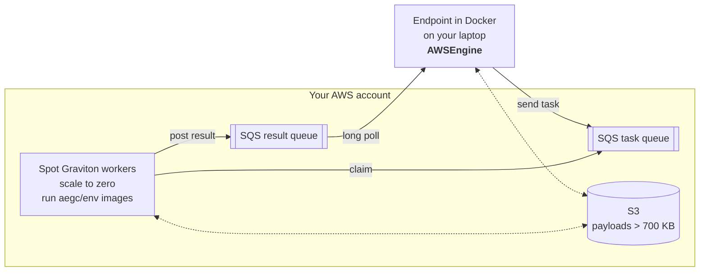

# aws-elastic-globus-compute

A [Globus Compute](https://www.globus.org/compute) endpoint engine, `AWSEngine`, that runs tasks on
ephemeral AWS capacity: an SQS work queue, and Graviton EC2 workers that run arm64 science containers
on stock AMIs. Capacity scales to zero when there's no work. No Parsl, no tunnels, no inbound ports,
no CloudFormation.

- **Every connection is outbound.** The endpoint and the workers both talk to AWS APIs; nothing dials
  in to the laptop.
- **Containers on stock AMIs.** Worker images are thin layers over any `linux/arm64` image with
  Python 3.11 or later: the signed images from [aarch.science](https://aarch.science/) and
  [aarch.bio](https://aarch.bio/), `python:3.13-slim`, or your own, with `globus-compute-endpoint`
  added. An env can have an image per Python minor, and each task goes to the one matching its
  submitter's Python.
- **Your data, any size.** Grants let tasks read and write your own S3 prefixes (requester-pays
  included), `aegc.outputs` returns results over Globus Compute's 10 MB limit as `s3://` URIs, and
  size classes give tasks up to 8 vCPUs and 32 GiB, or a whole instance, chosen per executor with
  `user_endpoint_config={"size": "mem"}`.
- **Tasks get only your grants.** Task processes run as an unprivileged user without instance
  metadata, with a task role that holds only the grants you gave, not the workers' own role.
- **See what ran where.** Workers log JSON, emit CloudWatch metrics (`aegc metrics`), and record
  each task's instance, image, timings and estimated cost (`aegc provenance`). Tasks can also come
  from Globus Flows and Timers.
- **Managed with boto3.** Every resource is tagged when it's created, and the tool only ever deletes
  resources that carry its tags.

## Documentation

<https://scttfrdmn.github.io/aws-elastic-globus-compute/>. Start with the
[quickstart](https://scttfrdmn.github.io/aws-elastic-globus-compute/quickstart/).

## Status

Early release (0.x): v0.3.0 adds bring-your-own images, several Python minors per env,
data-access grants, `aegc.outputs` and size classes to v0.2.0's spend limits, stop and resume,
lease and cost ledger. The main branch adds task isolation from the worker role, JSON logs,
CloudWatch metrics, provenance, and support for Globus Flows and Timers, not yet released. Work is
tracked in this repo's issues, milestones and project board.

Sister projects:
- [aws-elastic-gcs](https://github.com/scttfrdmn/aws-elastic-gcs): elastic Globus Connect Server.
- [aws-elastic-parsl](https://github.com/scttfrdmn/aws-elastic-parsl): fixes for Parsl's
  `AWSProvider`, and the HTEX-based Globus Compute setup this project replaces.

## License

Apache-2.0
