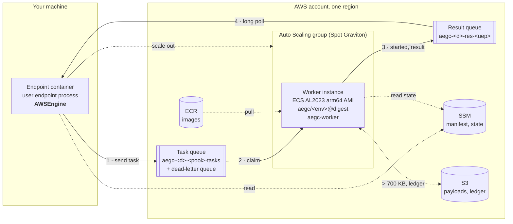
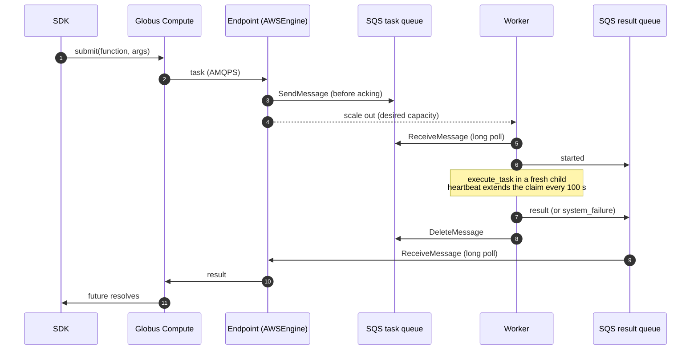
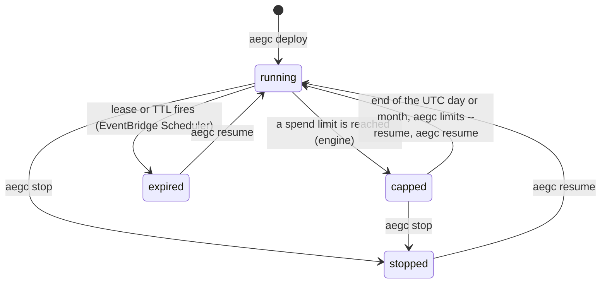

# Architecture



`<d>` is the deployment name, `<pool>` the pool name (`<env>-py<NNN>`, for example
`geospatial-py314`), and `<uep>` the first 12 hex digits of the user endpoint process's id.

## Components

**Endpoint container.** `aegc endpoint` runs a Globus Compute endpoint in Docker on your machine
(endpoints need Linux, so this also applies on macOS). Globus Compute starts one *user endpoint
process* per submitter runtime and per `user_endpoint_config`, from the template that
`aegc endpoint configure` writes. Each process runs one `AWSEngine`. The template passes the
submitter's Python minor version and the `user_endpoint_config` options (`env`, `size`, `cpus`,
`memory_gib`, `walltime_s`, `pool`) to the engine. They go there, not in `resource_specification`,
because the Globus Compute web service keeps only MPI fields in a task's `resource_specification`.

**Cloud endpoint (optional).** `aegc endpoint deploy` runs the same endpoint container on a
small on-demand Graviton instance, in an Auto Scaling group of one, with the same endpoint id
and your Globus login from Secrets Manager. The instance also runs `aegc evaluate` every
5 minutes, which checks spend limits, renews the lease and reaps idle result queues without
waiting for an engine, and publishes a liveness metric for an offline alarm. See
[Run the endpoint in the cloud](../how-to/cloud-endpoint.md).

**AWSEngine** ([src/aegc/engine.py](../../src/aegc/engine.py)) has three parts:

- `_submit` picks the pool and sends the task to its SQS queue *before returning*, because the
  endpoint acknowledges the task to Globus as soon as `submit` returns.
- A scaler thread runs every 10 s. For each pool it reads the queue depth and the Auto Scaling
  group and raises desired capacity to the vCPUs the waiting and running tasks need, capped at the
  pool's `max_vcpus` and at what the [spend limits](cost.md#spend-limits) admit. It only scales out;
  several endpoint processes can share a pool, and workers scale in themselves. The same thread
  checks spend, re-reads the deployment state and manifest, and renews the lease.
- A result thread long-polls the process's own result queue and resolves the matching futures.

The engine reads the deployment's manifest (`/aegc/<d>/manifest` in SSM Parameter Store) when it
starts, then re-reads it every 60 s and switches to it when its content hash (`generation`)
changes, so a redeploy or a change of limits reaches running endpoints within a minute. It reads
the [deployment state](#deployment-state) every 30 s. It is built to survive the endpoint's process
management: `start` is fast and never raises (a misconfiguration fails tasks with a clear message
instead), `shutdown` never touches AWS, and the status report only reads cached data.

**Queues.** Each pool has a task queue (visibility timeout 300 s, long polling) and a dead-letter
queue. Each user endpoint process creates its own result queue, which keeps messages for 14 days.

**Workers.** Each pool is an Auto Scaling group of Spot Graviton instances, chosen by attributes
(vCPU and memory ranges, AWS-designed CPUs, no burstable types) with the `price-capacity-optimized`
strategy, and sized in vCPUs (see [Capacity in vCPUs](#capacity-in-vcpus)). Instances run the stock ECS-optimized Amazon Linux 2023 arm64 AMI, resolved at deploy
time. Their user data ([src/aegc/infra/userdata.py](../../src/aegc/infra/userdata.py)) disables the
ECS agent, starts Docker, pulls the worker image by digest from ECR, and runs `aegc-worker run`
under systemd. A watchdog timer terminates the instance if the worker stays down, or once the
instance outlives its lifetime plus the pool's longest walltime plus 15 minutes; at the group's
minimum, it terminates it without lowering desired capacity, so the group launches a replacement.

**The worker agent** ([src/aegc/worker/agent.py](../../src/aegc/worker/agent.py)) runs one task per
slot (by default one slot per vCPU; a [size class](../how-to/configuration.md#size-classes)
gives each task more). Each task runs Globus Compute's own `execute_task` in a fresh
child process, forked from a server that has already imported Globus Compute, so a task starts in
about 30 ms. On images built with aegc 0.4 or later the child drops to uid 57439 before it
deserializes the task, can't reach instance metadata, and gets the deployment's task role instead
of the worker role; its result comes back over a pipe (see
[Task isolation](security.md#task-isolation)). The worker enforces walltime by killing the
child's process group. It logs JSON lines, emits CloudWatch metrics and adds provenance to each
result ([Watch tasks](../how-to/observability.md)). It also reads the
deployment state every 60 s, stops claiming after its lifetime (24 hours by default; at the group's
minimum it then terminates for a replacement), and writes
its [cost ledger](cost.md#cost-ledger) record at start, every 5 minutes and at exit.

**Payloads.** Task and result bodies up to 700,000 bytes travel inline in the SQS message, base64
encoded. Larger bodies go to the region's payload bucket under `payloads/<d>/` and the message
carries a pointer with a SHA-256 checksum.

**Images.** Worker images live in ECR as `aegc/<env>`, one per Python minor. `aegc image build`
makes them over an [aarchsci](https://aarch.science/) environment, an
[aarchbio](https://aarch.bio/) tool image, or any arm64 image with Python 3.11 or later, and
`aegc image register` brings in one you built. aarchsci and aarchbio bases are pulled through the
`aegc-quay` ECR pull-through cache, so pulls stay in-region. See
[Worker images](../how-to/images.md).

## Task path



1. The SDK submits a task to Globus. The endpoint receives it and calls `AWSEngine.submit()`.
2. If the deployment isn't `running`, the task fails at once with the state's code. Otherwise the
   engine resolves the pool from the options in `user_endpoint_config` (env, size, `cpus`,
   `memory_gib`, pool) and the submitter's Python version. If nothing matches, the task fails at
   once with an explanation.
3. The engine writes the payload to S3 if it's large, sends the task message to the pool's queue,
   and wakes the scaler, which raises the group's desired capacity.
4. A worker claims the message. Its heartbeat extends the claim every 100 s while the task runs. It
   posts a `started` message, runs the task, and posts the packed result (or a `system_failure`) to
   the result queue named in the task. Only then does it delete the task message.
5. The engine's result thread resolves the task's future, and the endpoint returns the result to
   Globus. If the endpoint process restarted in the meantime and no longer knows the task, the
   engine writes the result to `<run_dir>/unacked_results/`, and Globus Compute republishes it.
6. A worker with nothing to do for 300 s calls `TerminateInstanceInAutoScalingGroup` with
   `ShouldDecrementDesiredCapacity`, so the group shrinks instead of replacing it. With no work,
   every pool returns to zero.

See [Delivery and idempotency](delivery.md) for what happens when something fails along the way.

## Deployment state

Each deployment has a state in `/aegc/<d>/state`, a small JSON document with the mode, the reason,
when and by whom it was set, and for a cap, when it ends.



| State | Set by | Failure code | Ends |
|---|---|---|---|
| `running` | `aegc deploy` (once), `aegc resume` | | |
| `capped` | an engine, when estimated spend reaches a limit | `AEGC_BUDGET_EXCEEDED` | at the end of the limit's UTC day or month, or with `aegc limits --resume` or `aegc resume` |
| `stopped` | `aegc stop` | `AEGC_STOPPED` | `aegc resume` |
| `expired` | the lease or TTL schedules | `AEGC_EXPIRED` | `aegc resume` |

While the state isn't `running`:

- engines fail new tasks at once with the state's code and a message saying why and what to do;
- each engine fails its own queued tasks the same way, removes their messages from the task
  queues (leaving other processes' messages alone), and stops scaling out;
- workers stop claiming, fail any task they still receive, finish their running tasks, and leave
  their groups. With the state's `kill` flag (`aegc stop --hard`, or `--on-cap kill`), they fail
  running tasks at once instead.

These failures are final: the endpoint doesn't retry them. Workers read the state before their
first claim, so a worker that boots into a halted deployment never starts a task.

A redeploy never changes the state, and while the deployment isn't `running` it keeps every
group's minimum at 0, so it doesn't launch workers that couldn't take tasks; `aegc resume` restores
the minimums. When a cap ends at the end of its period, the engine restores them itself. A missing
state parameter (a v0.1 deployment) reads as `running`.

## Lease and TTL

A deployment that nobody uses shouldn't run forever. `aegc deploy` gives each deployment a lease,
48 hours by default (`--lease DURATION`, at least 3 hours; `--lease none` turns it off). It's a set of one-shot
EventBridge Scheduler schedules in a schedule group `aegc-<d>`:

- `lease-state` sets the state to `expired`, through Scheduler's universal target for
  `ssm:PutParameter`;
- `lease-<pool>`, one per pool, sets the group's minimum to 0 through
  `autoscaling:UpdateAutoScalingGroup`, so workers kept by `min_vcpus` can leave too.

They run as the role `aegc-<d>-scheduler-<region>`, which may only write the deployment's state
parameter and update groups tagged with the deployment. No Lambda function is involved.

Every running engine pushes the lease schedules forward while the deployment is `running` or
`capped`, every hour (or every third of the lease, if that's shorter), so a deployment with an
endpoint up never expires, and one capped until the end of the month doesn't expire meanwhile. A
[cloud endpoint](../how-to/cloud-endpoint.md#the-evaluator)'s `aegc evaluate` renews it too, but
only while Globus reports the endpoint online. If every endpoint stops (or loses its credentials)
for the length of the lease, the schedules fire.
`aegc resume` sets the state back to `running` and pushes the lease forward.

`--ttl DURATION` (for example `--ttl 7d`) adds the same schedules under `ttl-*`, at a fixed time
from the deploy. Nothing renews them, so the deployment expires then, endpoint or not, and tasks
are told the TTL was reached. `--ttl none` removes them. Both settings are kept across redeploys and
shown by `aegc status`; a TTL that has already passed isn't scheduled again.

## Capacity in vCPUs

Pools are sized in vCPUs, not instances: each group uses `DesiredCapacityType=vcpu`, and
`max_vcpus=` (default 8) and `min_vcpus=` (default 0) are its maximum and minimum. Spot's
`price-capacity-optimized` strategy can choose any size within the pool's `vcpu=` range (default
2–8), so a group capped at 8 vCPUs can run four 2-vCPU workers or one 8-vCPU worker, but either way
about the same capacity and cost. The largest worker size can't exceed `max_vcpus`: `deploy`
refuses a `vcpu=` range that does, and narrows the default range to fit a small `max_vcpus` (for
example `max_vcpus=4` gives `vcpu=2-4`).

The scaler asks for the vCPUs that the pool's demand needs (queued plus running tasks): with
`slots=auto`, one vCPU per task, or the size class's vCPUs per task (`whole`: the worker's vCPUs); with `slots=N`, one worker of the pool's smallest size per N tasks.
Under spend limits, the scaler asks in whole workers of the smallest size (a 1-vCPU demand becomes
a 2-vCPU worker) and admits whole workers. Auto Scaling can launch an instance larger than the
vCPUs it still needs, so a group can end up somewhat above its desired capacity; a narrow `vcpu=`
range keeps that small.

Deployments made by v0.1 counted workers. Their groups keep scaling in workers until they're
redeployed. The redeploy converts each pool at its largest size, the same bound v0.1 had
(`max_workers` × the top of its `vcpu=` range), while `max=`/`min=` given on the command line are
converted with the smallest size, with a warning.

## Python matching

Globus Compute serializes functions with the submitter's Python, so the worker must run the same
Python minor version. `aegc image build` and `aegc image register` read the Python version from
the image, and the env's record keeps one image per minor. The first `aegc deploy` of an env makes
a pool for each (a redeploy updates those, and `python=` adds another), and the pool name records
the minor (`-py314`, `-py313`). The engine routes each task to the pool whose
image matches the submitter. If there is none, the task fails with:

```
no worker image for Python 3.13 in env 'geospatial'; available: 3.14 (geospatial-py314). Submit
from a matching Python version.
```

The endpoint process itself never deserializes user functions, so the endpoint image's Python
doesn't have to match. It defaults to 3.14 so that `aegc endpoint test`, which submits from inside
the container, matches the aarchsci images; `aegc endpoint build --python 3.13` tests a 3.13 pool
instead.

## Design choices

- **No Parsl or HTEX.** HTEX workers connect in to the submit host. An SQS queue in the middle makes
  every connection outbound.
- **boto3, not CloudFormation or CDK.** Every create and delete is an idempotent `ensure_*` /
  `destroy_*` function, and every create call carries the ownership tags.
- **Containers on stock AMIs.** No custom AMIs to build or patch. A new AMI is picked up by
  redeploying.
- **Engine registration.** Globus Compute 4.x resolves `engine: type:` only from
  `globus_compute_endpoint.engines`. A `.pth` hook ([src/aegc/_register.py](../../src/aegc/_register.py))
  makes `AWSEngine` resolvable there, lazily, at a cost of about 0.3 ms per interpreter start.
- **AMQPS on port 5671.** On 443, connections were cut and the subscriber gave up
  ([globus/globus-compute#2232](https://github.com/globus/globus-compute/issues/2232)).
- **Endpoint processes stay up** (`idle_heartbeats_soft: 0`). Globus Compute's idle check counts
  results replayed from `unacked_results` as forwarded, so after a recovery it stopped the process
  while tasks were still running on AWS
  ([globus/globus-compute#2233](https://github.com/globus/globus-compute/issues/2233)). An idle
  process costs a few SQS long polls; AWS capacity drains itself regardless.
- **EventBridge Scheduler for the lease.** Its universal targets call SSM and Auto Scaling directly,
  so the lease needs no Lambda function or always-on process.
- **SQS limits shape the protocol.** A claim can't be extended past 12 hours, so walltime is capped
  at 41,400 s. Messages max out at 1 MiB, so large payloads go to S3.
