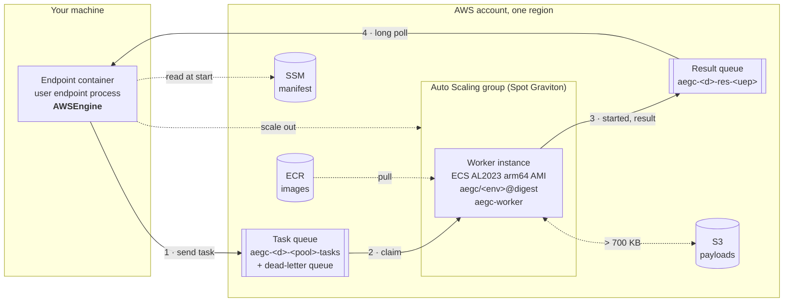
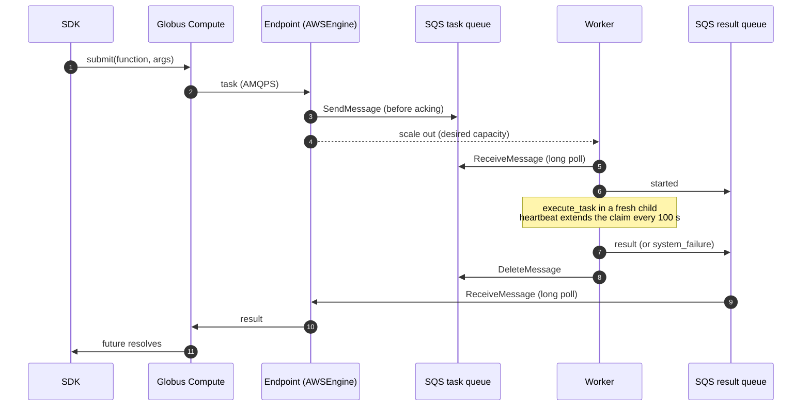

# Architecture



`<d>` is the deployment name, `<pool>` the pool name (`<env>-py<NNN>`, for example
`geospatial-py314`), and `<uep>` the first 12 hex digits of the user endpoint process's id.

## Components

**Endpoint container.** `aegc endpoint` runs a Globus Compute endpoint in Docker on your machine
(endpoints need Linux, so this also applies on macOS). Globus Compute starts one *user endpoint
process* per submitter runtime and per `user_endpoint_config`, from the template that
`aegc endpoint configure` writes. Each process runs one `AWSEngine`. The template passes the
submitter's Python minor version and the requested `env` to the engine.

**AWSEngine** ([src/aegc/engine.py](../../src/aegc/engine.py)) has three parts:

- `_submit` picks the pool and sends the task to its SQS queue *before returning*, because the
  endpoint acknowledges the task to Globus as soon as `submit` returns.
- A scaler thread runs every 10 s. For each pool it reads the queue depth and the Auto Scaling
  group, and raises desired capacity to `ceil(demand / slots)`, capped at the pool's maximum. It
  only scales out; several endpoint processes can share a pool, and workers scale in themselves.
- A result thread long-polls the process's own result queue and resolves the matching futures.

The engine reads the deployment's manifest (`/aegc/<d>/manifest` in SSM Parameter Store) when it
starts. It is built to survive the endpoint's process management: `start` is fast and never raises
(a misconfiguration fails tasks with a clear message instead), `shutdown` never touches AWS, and the
status report only reads cached data.

**Queues.** Each pool has a task queue (visibility timeout 300 s, long polling) and a dead-letter
queue. Each user endpoint process creates its own result queue, which keeps messages for 14 days.

**Workers.** Each pool is an Auto Scaling group of Spot Graviton instances, chosen by attributes
(vCPU and memory ranges, AWS-designed CPUs, no burstable types) with the `price-capacity-optimized`
strategy. Instances run the stock ECS-optimized Amazon Linux 2023 arm64 AMI, resolved at deploy
time. Their user data ([src/aegc/infra/userdata.py](../../src/aegc/infra/userdata.py)) disables the
ECS agent, starts Docker, pulls the worker image by digest from ECR, and runs `aegc-worker run`
under systemd. A watchdog timer terminates the instance if the worker stays down.

**The worker agent** ([src/aegc/worker/agent.py](../../src/aegc/worker/agent.py)) runs one task per
slot (by default one slot per vCPU). Each task runs Globus Compute's own `execute_task` in a fresh
child process, forked from a server that has already imported Globus Compute, so a task starts in
about 30 ms. The worker enforces walltime by killing the child's process group.

**Payloads.** Task and result bodies up to 700,000 bytes travel inline in the SQS message, base64
encoded. Larger bodies go to the region's payload bucket under `payloads/<d>/` and the message
carries a pointer with a SHA-256 checksum.

**Images.** Worker images live in ECR as `aegc/<env>`, built by `aegc image build` over an
[aarchsci](https://aarch.science/) environment (or an [aarchbio](https://aarch.bio/) tool image). Bases are pulled through the `aegc-quay` ECR pull-through cache, so pulls stay
in-region.

## Task path



1. The SDK submits a task to Globus. The endpoint receives it and calls `AWSEngine.submit()`.
2. The engine resolves the pool from `resource_specification`, the endpoint's `env`, and the
   submitter's Python version. If nothing matches, the task fails at once with an explanation.
3. The engine writes the payload to S3 if it's large, sends the task message to the pool's queue,
   and wakes the scaler, which raises the group's desired capacity.
4. A worker claims the message. Its heartbeat extends the claim every 100 s while the task runs. It
   posts a `started` message, runs the task, and posts the packed result (or a `system_failure`) to
   the result queue named in the task. Only then does it delete the task message.
5. The engine's result thread resolves the task's future, and the endpoint returns the result to
   Globus. If the endpoint process restarted in the meantime and no longer knows the task, the
   engine writes the result to `<run_dir>/unacked_results/`, and Globus Compute republishes it.
6. A worker with nothing to do for 300 s calls `TerminateInstanceInAutoScalingGroup` with
   `ShouldDecrementDesiredCapacity`, so the group shrinks instead of replacing it. With no work,
   every pool returns to zero.

See [Delivery and idempotency](delivery.md) for what happens when something fails along the way.

## Python matching

Globus Compute serializes functions with the submitter's Python, so the worker must run the same
Python minor version. `aegc image build` reads the Python version from the image it built, and the
pool name records it (`-py314`). The engine routes each task to a pool whose image matches the
submitter. If there is none, the task fails with:

```
no worker image for Python 3.13 in env 'geospatial'; available: 3.14 (geospatial-py314). Submit
from a matching Python version.
```

The endpoint process itself never deserializes user functions, so the endpoint image's Python
doesn't have to match. It defaults to 3.14 so that `aegc endpoint test`, which submits from inside
the container, matches the aarchsci images.

## Design choices

- **No Parsl or HTEX.** HTEX workers connect in to the submit host. An SQS queue in the middle makes
  every connection outbound.
- **boto3, not CloudFormation or CDK.** Every create and delete is an idempotent `ensure_*` /
  `destroy_*` function, and every create call carries the ownership tags.
- **Containers on stock AMIs.** No custom AMIs to build or patch. A new AMI is picked up by
  redeploying.
- **Engine registration.** Globus Compute 4.x resolves `engine: type:` only from
  `globus_compute_endpoint.engines`. A `.pth` hook ([src/aegc/_register.py](../../src/aegc/_register.py))
  makes `AWSEngine` resolvable there, lazily, at a cost of about 0.3 ms per interpreter start.
- **AMQPS on port 5671.** On 443, connections were cut and the subscriber gave up
  ([globus/globus-compute#2232](https://github.com/globus/globus-compute/issues/2232)).
- **Endpoint processes stay up** (`idle_heartbeats_soft: 0`). Globus Compute's idle check counts
  results replayed from `unacked_results` as forwarded, so after a recovery it stopped the process
  while tasks were still running on AWS
  ([globus/globus-compute#2233](https://github.com/globus/globus-compute/issues/2233)). An idle
  process costs a few SQS long polls; AWS capacity drains itself regardless.
- **SQS limits shape the protocol.** A claim can't be extended past 12 hours, so walltime is capped
  at 41,400 s. Messages max out at 1 MiB, so large payloads go to S3.
