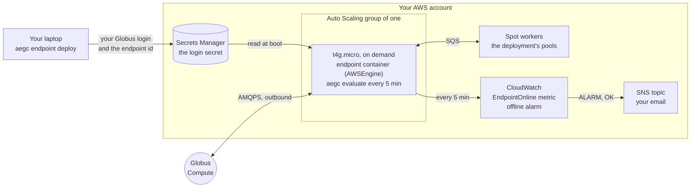

# Run the endpoint in the cloud

A laptop endpoint only takes tasks while the laptop is on. `aegc endpoint deploy` moves the
endpoint to a small on-demand Graviton instance in your account, with the **same endpoint id**,
so clients, flows and timers don't change. The instance also runs `aegc evaluate` every 5 minutes:
it checks the deployment's spend limits even when no task is running, keeps the lease renewed
while the endpoint is online, cleans up idle result queues, and publishes a liveness metric that
a CloudWatch alarm watches.



It's one endpoint per deployment, in the deployment's region. Everything it creates is named
`aegc-<d>-endpoint…` and removed by `aegc endpoint undeploy` or `aegc destroy`.

## Before you start

- **A deployment** in the region: `aegc deploy <d> ...` first. `endpoint deploy` checks, and
  refuses with `aegc: no deployment '<d>' in <region>; `aegc deploy <d> ...` first`.
- **A local endpoint that has registered once.** Run `aegc endpoint ... login`, `configure` and
  `start` as in the [quickstart](../quickstart.md), so the volume `aegc-endpoint-home` holds your
  Globus login and the endpoint's id. The cloud endpoint copies both.
- **Docker with buildx**, to build the endpoint image for `linux/arm64` (unless you pass
  `--image`).
- **AWS credentials** with the [deployer](../reference/iam.md#deployer) and
  [endpoint-deployer](../reference/iam.md#endpoint-deployer) policies, and the
  [builder](../reference/iam.md#builder) policy to push the endpoint image. An administrator
  profile works.

## Deploy it

```sh
ep() { aegc endpoint --name aegc-e2e --deployment e2e --env geospatial "$@"; }
ep deploy --stop-local --dry-run                  # what would change; stops and builds nothing
ep deploy --stop-local --alarm-email you@example.org
aegc endpoint --deployment e2e status
```

`deploy`:

1. checks that the deployment exists, and that the local endpoint isn't running: one endpoint id
   can run in only one place. With `--stop-local` it stops the local endpoint; without it, it
   refuses with `the local endpoint <name> is running (...); one endpoint id can run in one place.
   Stop it, or pass --stop-local`;
2. reads your Globus login (`storage.db`), the endpoint id and the local endpoint's allowed
   functions from the volume `aegc-endpoint-home`;
3. builds the endpoint image for `linux/arm64` and pushes it to the ECR repository
   `aegc/endpoint`, tagged `py<python>-gce<version>-aegc<version>-w<wheel hash>` (an existing tag
   is reused), unless you pass `--image`;
4. stores the login in the Secrets Manager secret `aegc-<d>-endpoint`;
5. creates or updates the host's role, launch template and Auto Scaling group, and the offline
   alarm.

It prints a report, one line per resource, and then
`cloud endpoint <name> (<id>) is starting on t4g.micro; ...`. The endpoint comes online about
3 minutes later. `status` shows the host and the alarm:

```
cloud endpoint of e2e (us-west-2):
  instance: i-0123456789abcdef0 t4g.micro InService
  endpoint: aegc-e2e (6f0c1e1a-...)
  alarm aegc-e2e-endpoint-offline: OK
```

`status` doesn't ask Globus. To check that the endpoint is online, use the SDK
(`Client().get_endpoint_status("<id>")`) or run the [evaluator](#the-evaluator) as a dry run from
your laptop.

Tasks then run as before. In the live run a task submitted from the SDK with the laptop endpoint
stopped came back in 40 s.

| Option | Default | Meaning |
|---|---|---|
| `--env ENV` | required | The default science environment, as for `configure` |
| `--name NAME` | `aegc` | The local endpoint whose login and id move to the cloud |
| `--deployment D` | `default` | The deployment the endpoint serves |
| `--instance-type TYPE` | `t4g.micro` | The host's instance type; Graviton, because the endpoint image is arm64. Only subnets in zones that offer it are used |
| `--alarm-email ADDRESS` | | Email this address when the endpoint goes offline (and when it's back). A redeploy without it keeps the existing topic and its subscriptions |
| `--image IMAGE` | build one | An endpoint image already in `aegc/endpoint`, pinned by digest: `<registry>/aegc/endpoint@sha256:...` |
| `--python 3.NN` | `3.14` | Python in the endpoint image, when `deploy` builds it |
| `--project-dir DIR` | `.` | The aegc source tree to build the image from |
| `--allow-function ID` | the local endpoint's list | Only these function ids may run (repeatable); `none` allows any. See [Allow only your functions](flows.md#allow-only-your-functions) |
| `--stop-local` | off | Stop the local endpoint if it's running |
| `--session-manager` | off | Let Session Manager open shells on the host (see [Security](#security)) |
| `--dry-run` | off | Report what would change. Stops nothing, builds nothing, writes nothing |

## What it creates

| Resource | Name | `aegc:role` |
|---|---|---|
| IAM role and instance profile, path `/aegc/`, inline policy `aegc-endpoint` ([endpoint](../reference/iam.md#endpoint)); trusts EC2 | `aegc-<d>-endpoint-<region>` | `endpoint-role` |
| Launch template: the ECS-optimized AL2023 arm64 AMI, IMDSv2 with hop limit 2, 30 GiB encrypted gp3, the deployment's security group (no ingress) | `aegc-<d>-endpoint` | `lt` (with `aegc:pool=endpoint`) |
| Auto Scaling group, minimum, maximum and desired 1, `AZRebalance` suspended | `aegc-<d>-endpoint` | `endpoint-asg` |
| EC2 instance and volume (launched by the group) | | `endpoint` |
| Secrets Manager secret: the endpoint's name and id, your Globus token storage, and the liveness metric's token | `aegc-<d>-endpoint` | `endpoint-secret` |
| CloudWatch alarm | `aegc-<d>-endpoint-offline` | `endpoint-alarm` |
| SNS topic and email subscription, with `--alarm-email` | `aegc-<d>-endpoint-alarm` | `endpoint-alarm` |
| ECR repository (created once, like worker image repositories) and an `inuse-<d>-<sha12>` tag on the image while it's deployed | `aegc/endpoint` | `image-repo` |
| Log streams in the deployment's log group `/aegc/<d>` | `endpoint/<instance-id>`, `endpoint/<instance-id>/evaluate` | |

The env name `endpoint` is reserved for the image repository. See
[Resources and tags](../reference/resources.md#cloud-endpoint-aegc-endpoint-deploy).

## Identity: it runs as you

The cloud endpoint is your endpoint, not a new one:

- **Your Globus login.** `deploy` copies the token storage from `aegc-endpoint-home` into the
  secret, and the host restores it at boot. Globus sees the same owner and the same endpoint id,
  so whoever could submit before still can, and nobody else.
- **One endpoint id, one place.** Don't start the local endpoint again while the cloud one runs.
  `deploy` refuses while it's running (unless `--stop-local`), and refuses an id that's already
  another deployment's cloud endpoint: `endpoint <name> (<id>) is already the cloud endpoint of
  deployment <d2>; one endpoint id can run in one place (`aegc endpoint undeploy` it there first)`.
- **Allowed functions carry over.** Without `--allow-function`, the cloud endpoint gets the local
  endpoint's `allowed_functions`. `--allow-function ID` replaces the list, and `none` removes it.
- **A new login replaces the host.** If the stored login has changed since the last deploy (you
  ran `aegc endpoint ... login` again, say), deploy again: the secret is updated, and the host is
  replaced to pick it up.

## Security

- **Only the host can read the login.** The secret has a resource policy that denies
  `secretsmanager:GetSecretValue` to every principal except the endpoint's role, whatever their
  IAM policies allow. The endpoint-deployer policy has no `GetSecretValue` at all; `status` reads
  the endpoint's name and id from the secret's tags. An administrator who can change the secret's
  resource policy could still remove the deny, so keep `secretsmanager:PutResourcePolicy` and
  `DeleteResourcePolicy` on `aegc-*` secrets to people you'd trust with your Globus login.
- **The host has no way in.** No inbound rules (it uses the deployment's security group,
  `aegc-<d>-workers`), no SSH key, IMDSv2 only. The login is on its encrypted volume under
  `/var/lib/aegc-endpoint/gc`, mode 700. Its role is the [operator](../reference/iam.md#operator)
  policy, which a laptop endpoint needs too, plus reading its own secret, pulling the endpoint
  image, writing its log streams, publishing its liveness metric, marking itself unhealthy and
  deleting the deployment's result queues.
- **Session Manager is opt-in.** With `--session-manager`, the role also allows Session Manager,
  for a shell without SSH. Anyone allowed `ssm:StartSession` on the instance then gets root on it,
  and with it your Globus login and the role's credentials. Leave it off unless you need it, and
  deploy again without it when you're done (that replaces the host).
- **What the login can do.** The tokens are the ones `globus-compute-endpoint login` got for you.
  Whoever holds them can act as you in Globus Compute, including submitting tasks to **any**
  endpoint you may use, not only this one. If you think they've leaked, revoke them:

    ```sh
    docker run --rm -it -v aegc-endpoint-home:/home/gc/.globus_compute aegc-endpoint \
      globus-compute-endpoint logout
    ```

    `logout` revokes the tokens with Globus, so the copy in the secret stops working too, and the
    cloud endpoint goes offline. Log in again and deploy again to bring it back.
- **The liveness metric can't be faked by tasks.** `EndpointOnline` carries a `Token` dimension
  that only the host knows (it's in the secret, and in the secret's tags). Task code can print
  CloudWatch EMF into worker logs, but it can't guess the token, so it can't keep the alarm quiet.

See also the [Security model](../concepts/security.md#the-cloud-endpoint).

## Replacement

The group keeps exactly one host. If the instance dies, is terminated, or fails its EC2 health
check, the group launches another with the same endpoint id. In the live run, a host was
terminated; its replacement came up as the same endpoint and its user endpoint process recovered a
result the old host had left in the result queue.

A redeploy replaces the running host when its launch template changes (a new image, instance
type, env, allowed functions or `--session-manager`) or the stored login changes. The host reads
all of these only at boot, so `deploy` starts an instance refresh, reported as
`updated  instance refresh`. It terminates the old host before it launches the new one, so the
endpoint is offline for a few minutes; two hosts on one endpoint id would fight each other, and
`AZRebalance` is suspended for the same reason.

At boot the host retries pulling the image, reading the secret and configuring the endpoint. If
one of them still fails, it marks itself unhealthy, and the group replaces it rather than keeping
a host that costs money and does nothing.

## The evaluator

A systemd timer on the host runs `aegc evaluate <d> --endpoint-id <id>` in the endpoint image,
3 minutes after boot and every 5 minutes after that. Each pass:

1. **Liveness.** Asks Globus whether the endpoint is online, and publishes `EndpointOnline` (1 or
   0) with PutMetricData, in the namespace `aegc/endpoint` with the dimensions `Deployment` and
   `Token`.
2. **Spend limits.** If the deployment is running and has limits, it checks spend from the cost
   ledger and trips a cap the way an engine does: the state becomes `capped` with `by: evaluator`,
   and the groups' minimums drop to 0. Engines run only in user endpoint processes, which start
   when a task arrives, so without this a deployment's limits went unchecked while no task
   came in. In the live run, a $0.0001/day limit on a host with no user endpoint process tripped
   on the first pass: `$0.0087 of $0.0001/day`.
3. **Lease.** Renews the [lease](../concepts/architecture.md#lease-and-ttl) (hourly, as engines do),
   but only while Globus reports the endpoint online. The lease stays a dead-man switch: if the
   endpoint is gone, the deployment still freezes when it runs out.
4. **Reap.** Deletes the deployment's result queues that are empty and haven't changed for
   14 days, as [`aegc reap`](operations.md#clean-up-result-queues) does.

It logs a short report to the stream `endpoint/<instance-id>/evaluate`:

```
evaluate e2e: endpoint online, state running
  delete idle result queue aegc-e2e-res-0123456789ab
```

and exits 1 if a step failed (each failure is an `error:` line). You can run the same pass from
your laptop, changing nothing, with operator credentials:

```sh
aegc evaluate e2e --dry-run                          # caps and result queues
aegc evaluate e2e --dry-run --endpoint-id <uuid>     # also ask Globus, as your SDK login
```

A dry run says `would cap it: ...`, `would renew the lease ...` or
`would delete idle result queue ...`, and publishes no metric. Without `--endpoint-id` it skips
the liveness check, and with it the lease.

## The offline alarm

`aegc-<d>-endpoint-offline` watches `EndpointOnline`: the maximum over 5-minute periods, below 1
for 3 periods in a row, with missing data counted as breaching. So it fires when Globus reports
the endpoint offline, and also when the metric stops coming: the host is gone, or `evaluate`
keeps failing. In the live run it went to `ALARM` about 25 minutes after the last datapoint (three
periods plus CloudWatch's evaluation delay); expect 20 to 25 minutes.

`deploy` publishes one datapoint itself, so a new alarm doesn't start in `ALARM` while the host
boots. With `--alarm-email`, the alarm notifies the SNS topic `aegc-<d>-endpoint-alarm` when it
goes to `ALARM` and when it's back to `OK`. AWS sends a confirmation email first; nothing arrives
until you confirm it. Another `--alarm-email` on a later deploy adds that address; remove one with
`aws sns unsubscribe`. Without any, the alarm still changes state, in the console and in
`aegc endpoint status`.

## Logs

The host logs to the deployment's log group, `/aegc/<d>`, next to the workers:

- `endpoint/<instance-id>`: the endpoint container. Lines from user endpoint processes, where
  `AWSEngine` runs, are copied in with a `[uep]` prefix.
- `endpoint/<instance-id>/evaluate`: each evaluator pass.

```sh
aws logs tail /aegc/e2e --log-stream-name-prefix endpoint/ --follow
```

The boot script logs to `/var/log/aegc-boot.log` on the instance, and to its console:
`aws ec2 get-console-output --instance-id <id> --output text`. See
[Troubleshooting](troubleshooting.md#the-cloud-endpoint-is-offline).

## Cost

The host runs all the time, on demand, and **`aegc cost` and the spend limits don't count it**:
they cover the workers. In us-west-2 in November 2026 the host was about $12 a month ($0.40 a
day), plus under $1 for the rest:

| Item | Price | A month |
|---|---|---|
| `t4g.micro` on demand | $0.0084 per hour | about $6.15 |
| Public IPv4 address | $0.005 per hour | about $3.65 |
| 30 GiB gp3 root volume | $0.08 per GB-month | $2.40 |
| The secret, the alarm and the `EndpointOnline` metric | $0.40, $0.10 and $0.30 a month | $0.80 |

The instance and its volume are tagged with the deployment, so
[`aegc cost --actual`](../concepts/cost.md#cost-explorer-and-cost-allocation-tags) includes them
once the cost allocation tags are active. A larger `--instance-type` costs more.

## Move back, or remove it

```sh
aegc endpoint --deployment e2e undeploy           # dry run: what would go
aegc endpoint --deployment e2e undeploy --yes
ep start                                          # back on your laptop, same id
```

`undeploy --yes` deletes the group (and waits for the host to go), the launch template, the alarm
and its topic, the image's `inuse-` tag, the instance profile and role, and the secret. The image
stays in `aegc/endpoint`, where the repository's lifecycle policy expires it. `aegc destroy`
removes the cloud endpoint with the rest of the deployment; see
[Destroy a deployment](operations.md#destroy-a-deployment).

`undeploy` and `status` need the endpoint-deployer policy as well as the deployer policy.
