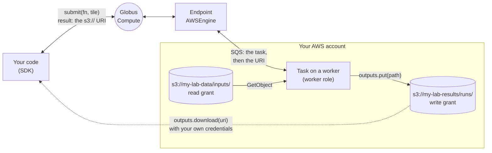

# Read and write your data

By default, workers can reach only aegc's own resources, so tasks read open data unsigned and send
their results back through Globus Compute, which caps a result at about 10 MB. Two features lift
those limits:

- **Grants** let every task in a deployment read, or write, under S3 prefixes of yours:
  `aegc deploy <d> --grant read=s3://bucket/prefix`.
- **`aegc.outputs`** writes a large result under a write grant from inside a task and returns its
  `s3://` URI, which is small enough to go back through Globus Compute.



## Grant access to your buckets

```sh
aegc deploy e2e --pool geospatial \
  --grant read=s3://my-lab-data/inputs/ \
  --grant write=s3://my-lab-results/runs/
```

Each `--grant` is `read=s3://BUCKET/PREFIX` or `write=s3://BUCKET/PREFIX`, and is repeatable. aegc
puts them in an inline policy, `aegc-grants`, on the deployment's worker role (see the
[IAM reference](../reference/iam.md#aegc-grants)):

| Grant | Allows |
|---|---|
| `read=` | `s3:GetObject` and `s3:GetObjectVersion` on keys under the prefix, and `s3:ListBucket` on the bucket for keys under it |
| `write=` | `s3:PutObject`, `s3:AbortMultipartUpload` and `s3:ListMultipartUploadParts` on keys under the prefix, so multipart uploads work |

A write grant doesn't allow reading or deleting. If tasks read back what other tasks wrote, grant
`read=` on the same prefix as well.

The prefix is literal: `s3://my-lab-data/in` also covers `s3://my-lab-data/inside/`, so end a
folder with `/`. `s3://my-lab-data/`, with the slash, grants the whole bucket; `s3://my-lab-data`
without one is refused as ambiguous.

aegc only refers to your buckets. It never creates, changes or deletes them, their policies or
their objects. Redeploys keep the grants:

```sh
aegc deploy e2e --pool geospatial                                   # keeps the grants
aegc deploy e2e --pool geospatial --grant read=s3://my-lab-data/v2/ # replaces all of them
aegc deploy e2e --pool geospatial --grant none                      # removes them
```

`--grant` replaces the whole list, so give every grant you want to keep. `--grant none` deletes the
`aegc-grants` policy, and can't be combined with other grants. The deploy report has a line for the
policy:

```
     updated  iam role policy            aegc-grants (2 grant(s))
```

or `deleted` when the grants were removed. `aegc status` doesn't list grants; to see a
deployment's current ones:

```sh
aws iam get-role-policy --role-name aegc-e2e-worker-us-west-2 --policy-name aegc-grants
```

IAM changes reach running workers within seconds. The list of write grants that `aegc.outputs`
uses is in the launch template, though, so after changing write grants, new workers see the new
list and running ones keep the one they booted with until they drain.

### What a grant can't be

`aegc deploy` refuses, before it changes anything:

- **Wildcards and policy variables** (`*`, `?`, `${`): `grants can't use wildcards: ...`.
- **Bucket names S3 wouldn't accept** for a general purpose bucket, including access point and
  directory bucket aliases: `not a valid general purpose S3 bucket name: ...`.
- **aegc's own bucket**, `aegc-<account>-<region>`: workers already have exactly what they need
  there.
- **Prefixes over 1,024 bytes**, S3's key length.
- **More grants than fit.** All of a role's inline policies share 10,240 characters, and
  `aegc-worker` uses about 1,900 of them. That leaves room for roughly a hundred grants or more,
  depending on their length. The error says how many characters the grants need and how many are
  left: `deployment e2e's 150 grants need a 8830-character IAM policy, but the worker role has room
  for 8340 ...; use fewer, broader prefixes`.

### Buckets in another account, and KMS

A grant adds permissions to the worker role in your account. A bucket in another account must
also allow the role in its bucket policy: its ARN is
`arn:aws:iam::<account>:role/aegc/aegc-<d>-worker-<region>`. A bucket encrypted with a customer
managed KMS key needs `kms:Decrypt` (to read) or `kms:GenerateDataKey` (to write) on that key,
which aegc doesn't grant.

### Requester-pays buckets

Requester-pays buckets need no extra IAM: grant the prefix, and ask for the data as the payer. Your
account pays for the requests and any data transfer. For example, the USGS Landsat archive in
us-west-2:

```sh
aegc deploy e2e --pool geospatial --grant read=s3://usgs-landsat/collection02/
```

```python
def band_stats(key):
    import os

    import boto3
    import rasterio

    s3 = boto3.client("s3")
    path = "/scratch/" + key.rsplit("/", 1)[-1]  # tasks on a worker share /scratch
    s3.download_file("usgs-landsat", key, path, ExtraArgs={"RequestPayer": "requester"})
    with rasterio.open(path) as src:
        band = src.read(1, masked=True)
    os.remove(path)
    return {"mean": float(band.mean()), "std": float(band.std())}
```

Use `RequestPayer="requester"` with `get_object` and `list_objects_v2`, and
`ExtraArgs={"RequestPayer": "requester"}` with `download_file`. For GDAL and rasterio reading
`s3://` paths directly, set `AWS_REQUEST_PAYER=requester`. `aegc.outputs.get` and
`aegc.outputs.download` don't send it, so read requester-pays data with boto3.

Open data in buckets you don't have a grant for still has to be read unsigned, as before; see
[Security model](../concepts/security.md#data-access).

## Return large outputs

Inside a task, `aegc.outputs.put` uploads data to S3 under the deployment's first write grant and
returns the `s3://` URI. This task reads a year of monthly arrays for a tile through a read grant,
writes their median, which can be far bigger than Globus Compute's 10 MB, through a write grant,
and returns the URI:

```sh
aegc deploy e2e --pool geospatial \
  --grant read=s3://my-lab-data/inputs/ \
  --grant write=s3://my-lab-results/runs/
```

```python
from globus_compute_sdk import Executor


def composite(tile):
    import shutil
    from pathlib import Path

    import boto3
    import numpy as np
    from aegc import outputs

    s3 = boto3.client("s3")
    work = Path("/scratch") / f"composite-{tile}"
    work.mkdir(exist_ok=True)
    months = []
    for m in range(1, 13):
        path = work / f"{m:02d}.npy"
        s3.download_file("my-lab-data", f"inputs/{tile}/2026-{m:02d}.npy", str(path))
        months.append(np.load(path))
    out = work / f"{tile}-median.npy"
    np.save(out, np.median(np.stack(months), axis=0))
    uri = outputs.put(out)  # s3://my-lab-results/runs/<task uuid>/<tile>-median.npy
    shutil.rmtree(work)
    return uri


with Executor(
    endpoint_id=ENDPOINT_ID, amqp_port=5671, user_endpoint_config={"env": "geospatial"}
) as ex:
    futures = [ex.submit(composite, tile) for tile in ("10SEG", "10SFG", "10TEK")]
    uris = [f.result() for f in futures]
```

Then fetch the results on your own machine, with your own AWS credentials and aegc installed:

```python
from aegc import outputs

for uri in uris:
    outputs.download(uri, uri.rsplit("/", 1)[-1])
```

Keys are `<grant prefix>/<task uuid>/<name>`, so tasks never overwrite each other, and a rerun of
the same task (after a Spot interruption, say) writes the same key again rather than a second
copy. Workers set `AEGC_TASK_UUID` for each task; `outputs.task_uuid()` returns it.

### The functions

| Function | What it does |
|---|---|
| `outputs.put(data, name=None, *, prefix=None)` | Upload `data` and return its `s3://` URI. `data` is bytes, a `str` (uploaded as UTF-8 text), or a `pathlib.Path` to a file; large files go up in parts. `name` defaults to the file's name, or `output-<n>`. `prefix="s3://bucket/some/prefix"` writes there instead, and must be inside a write grant. Only on a worker. |
| `outputs.get(uri)` | The object's bytes |
| `outputs.download(uri, path)` | Download the object to `path`, in parts if it's large; returns the path |
| `outputs.uri_to_https(uri, *, expires_s=0, region=None)` | An `https://` URL for the object. With `expires_s`, a presigned GET URL that anyone can use until it expires; without, the plain virtual-hosted URL, which works only if the object is readable some other way |

`get`, `download` and `uri_to_https` work anywhere with credentials that can read the object: in a
task with a read grant on the prefix, or on your own machine.

!!! warning "Pass a `Path`, not a string, for a file"
    `outputs.put("/scratch/out.nc")` uploads the text `/scratch/out.nc`, not the file. Use
    `outputs.put(Path("/scratch/out.nc"))`.

If there's no write grant, or `prefix` is outside every write grant, `put` raises
`PermissionError` before uploading anything, and says which `--grant` to add:

```
PermissionError: no write grant: deploy with `aegc deploy <d> --grant write=s3://bucket/prefix`
```

A few more things to know:

- **Presign links on your machine.** A URL presigned on a worker stops working when the instance
  role's credentials expire, a few hours later, even if `expires_s` is longer.
- **Use `/scratch` for big files.** It's on the worker's root volume (`disk=` GiB, 30 by default),
  shared by the tasks on that worker. Delete what you've uploaded.
- **Storage is yours.** The objects stay in your bucket until you, or a lifecycle rule of yours,
  delete them. aegc's cost estimates don't include them.
- **Rebuild older worker images.** `aegc.outputs` and `AEGC_TASK_UUID` need workers built from this
  release's code; see [worker images](images.md#things-to-know).

## Security

A grant extends the deployment's trust domain to your prefix. Every task in the deployment, from
anyone who can submit to its endpoints, can read everything a read grant covers and overwrite
anything a write grant covers, including other tasks' outputs. So:

- Grant the narrowest prefixes that do the job, and use a separate deployment for work that
  shouldn't share them.
- Turn on S3 Versioning on a bucket you grant writes to, if an overwrite would hurt.
- Don't grant access to data that some submitters mustn't see.

See [Security model](../concepts/security.md#data-access).
