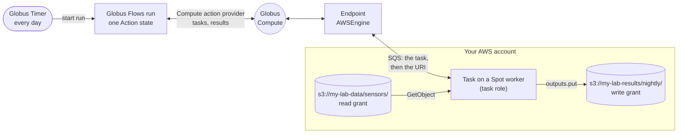

# Use aegc from Globus Flows and Timers

[Globus Flows](https://docs.globus.org/api/flows/) runs a Compute task as a step of a flow,
through the Globus Compute action provider, and [Globus Timers](https://docs.globus.org/api/timers/)
starts a flow on a schedule. Both work with an aegc endpoint. This guide builds a nightly job: a
timer starts a one-step flow, the task reads yesterday's input under a read grant, writes a
summary with [`aegc.outputs`](data.md#return-large-outputs), and returns the summary's `s3://` URI.



What's here was checked live on 2026-11-16 with the Compute action provider v3 and
`globus-compute-endpoint` 4.21.0 (see
[Performance](../reference/performance.md#v04-live-run-2026-11-16)).

## Before you start

- **An endpoint configured by aegc 0.4.** The `python` key below is new in 0.4's endpoint schema:
  run `aegc endpoint ... build` and `configure`, then `stop` and `start`.
- **A deployment with grants** for the data the task reads and writes:

    ```sh
    aegc deploy e2e --pool geospatial \
      --grant read=s3://my-lab-data/sensors/ --grant write=s3://my-lab-results/nightly/
    ```

- **The Globus CLI** (`pip install globus-cli`), logged in as **the endpoint owner**, the identity
  you used for `aegc endpoint ... login`. See [Use the right identity](#use-the-right-identity).
- **Flows access.** Without a Globus subscription, Flows' free tier allows one flow per user, for
  30 days. A subscription lifts that.

## Register the function

The action provider sends a task's arguments as JSON from the flow's state, and Flows can only
keep JSON in its state. So register the function **as source text**, with
`PureSourceTextInspect`, and keep its arguments and return value JSON: strings, numbers, lists
and dicts. A source-serialized function carries only its own text, so do the imports inside it.

```python
# register_nightly.py: run it as a file (the serializer reads the function's source)
from globus_compute_sdk import Client
from globus_compute_sdk.serialize import PureSourceTextInspect


def nightly_summary(bucket, prefix):
    import collections
    import csv
    import io
    import json
    import statistics
    from datetime import UTC, datetime, timedelta

    import boto3
    from aegc import outputs

    day = (datetime.now(UTC) - timedelta(days=1)).strftime("%Y-%m-%d")
    key = f"{prefix}{day}.csv"
    body = boto3.client("s3").get_object(Bucket=bucket, Key=key)["Body"].read()
    rows = list(csv.DictReader(io.StringIO(body.decode())))
    values = [float(r["value"]) for r in rows]
    summary = {
        "day": day,
        "rows": len(rows),
        "mean": statistics.fmean(values),
        "max": max(values),
        "by_sensor": dict(collections.Counter(r["sensor"] for r in rows)),
    }
    uri = outputs.put(json.dumps(summary).encode(), name=f"{day}.json")
    return {"day": day, "rows": len(rows), "summary": uri}


gcc = Client(code_serialization_strategy=PureSourceTextInspect())
print(gcc.register_function(nightly_summary))
```

It prints the function id. Register it as the endpoint owner too. Inside the task, boto3 finds the
task role's credentials and the region by itself (see
[Task isolation](../concepts/security.md#task-isolation)); `outputs.put` writes to
`s3://my-lab-results/nightly/<task uuid>/<day>.json`.

## Allow only your functions

An endpoint runs any function its owner can submit. For an endpoint that a flow, or a timer,
calls unattended, limit it to the functions you registered:

```sh
aegc endpoint --name aegc-e2e --deployment e2e --env geospatial configure \
  --allow-function 6f1e2d3c-4b5a-4968-8776-655443322110
aegc endpoint --name aegc-e2e stop
aegc endpoint --name aegc-e2e start
```

`--allow-function` is repeatable, and writes `allowed_functions` into the endpoint's
`config.yaml`. Globus learns the list when the endpoint starts, so restart it; `configure` says
so:

```
allowed functions: 6f1e2d3c-4b5a-4968-8776-655443322110; restart the endpoint (stop, start) for Globus to enforce it
```

From then on, Globus refuses any other function at submission with `403 FUNCTION_NOT_PERMITTED`,
and the endpoint's user endpoint processes check the list too. So a stolen token, or a flow run
with unexpected input, can only run the functions you approved. `--allow-function none` removes
the list (any function), and `configure` without the option leaves it as it is. Re-registering a
changed function gives it a new id: add the new one.

## Write the flow

A flow with one Action state that calls the Compute action provider, `nightly.json`:

```json
{
  "Comment": "aegc: yesterday's sensor summary",
  "StartAt": "Summarize",
  "States": {
    "Summarize": {
      "Type": "Action",
      "ActionUrl": "https://compute.actions.globus.org/v3",
      "Parameters": {
        "endpoint_id": "<endpoint id>",
        "user_endpoint_config": {"env": "geospatial", "python": "3.14"},
        "tasks": [
          {"function_id": "6f1e2d3c-4b5a-4968-8776-655443322110", "args.$": "$.args"}
        ]
      },
      "ResultPath": "$.Summary",
      "WaitTime": 1800,
      "End": true
    }
  }
}
```

- **`endpoint_id`** is what `aegc endpoint ... id` prints.
- **`user_endpoint_config`** takes the same keys as from the SDK (`env`, `size`, `cpus`,
  `memory_gib`, `walltime_s`, `pool`; see the
  [reference](../reference/configuration.md#user_endpoint_config)), plus **`python`**. Flows
  doesn't send the submitter's Python version with a task, as the SDK does. With one Python minor
  in the env, the task goes to it; with several, the engine refuses it:

    ```
    this submission doesn't say its Python version (Globus Flows doesn't send one), and env
    'geospatial' has worker images for 3.13, 3.14; add "python": "3.14" (your function's Python)
    to user_endpoint_config
    ```

    Set `python` anyway, so adding a minor to the env later doesn't break the flow. When a
    submission does carry a Python version (from the SDK), that one wins.
- **`tasks`** is a list of `{"function_id", "args"}` (and `kwargs`, if you like). `"args.$":
  "$.args"` takes the list from the run's input; a literal `"args": [...]` works too.
- **`ResultPath`** is where the action's output goes in the run's state, here `$.Summary`.
- **`WaitTime`** is how long Flows waits for the action, in seconds. The default, 300 s, is too
  short for a pool that starts from zero: a cold start takes about 40 s, then the task waits for
  its turn in the queue and runs for up to its walltime. Allow for all three. The live run took
  about 37 s from start to `SUCCEEDED` on a warm pool.
- **Not `resource_specification`.** As from the SDK, it's MPI-only; aegc's options go in
  `user_endpoint_config`.

The action runs as the identity that started the run (`RunAs` `User`, the default), and that must
be the endpoint owner. A run started by anyone else fails at once with
`ENDPOINT_ACCESS_FORBIDDEN`; it doesn't wait. Identities that aren't among the flow's starters
don't see the flow at all (`NOT_FOUND`).

## Run it

```sh
globus flows create "aegc nightly summary" nightly.json     # prints the flow id
globus flows start <flow id> --label first-try \
  --input '{"args": ["my-lab-data", "sensors/"]}'           # prints the run id
globus flows run show <run id>
```

The first `start` may ask for consent to the flow's scopes; `globus login --flow <flow id>` gives
it. When the run is `SUCCEEDED`, the action's output is in the run's state at `Summary`:

- **`details.result[0]`** is the function's return value, here
  `{"day": "2026-11-15", "rows": 1440, "summary": "s3://my-lab-results/nightly/<task uuid>/2026-11-15.json"}`;
- **`details.results`** lists `{"task_id", "output"}` per task.

**Return references, not data.** A run's state is limited to about 200 KB, so return URIs from
`aegc.outputs` (or keys of your own) rather than the data, and fetch the data with
`outputs.download` or the AWS CLI.

**Provenance.** The action's output doesn't include the result's `details["aegc"]`. Use the task
id from `details.results` with [`aegc provenance`](observability.md#aegc-provenance):

```sh
aegc provenance e2e <task id>
```

If the function raises, or aegc refuses the task (as with the `python` refusal above), the task
fails, and so does the action.

## Run it every night

Give the timer service consent to start the flow, as the endpoint owner, then create the timer:

```sh
globus login --timer flow:<flow id>
globus timer create flow <flow id> --name aegc-nightly \
  --start '2026-11-17T06:00:00+00:00' --interval 1d \
  --input '{"args": ["my-lab-data", "sensors/"]}'
globus timer list
```

Each night the timer starts a run, the run submits the task, the pool starts a worker, and the
worker leaves again about 5 minutes after the task. For a first test, `--stop-after-runs 1` runs
the flow once and ends the timer; the live run did that and the run `SUCCEEDED`.

Keep the endpoint running. What the action provider does when the endpoint is offline hasn't been
tested, and a running endpoint also renews the deployment's
[lease](../concepts/architecture.md#lease-and-ttl), which otherwise expires after 48 hours. Spend
limits apply as usual.

## Use the right identity

Most Flows problems with aegc are identity problems. The flow run, the timer's consent and the
function registration should all be the endpoint owner's identity. Compare:

```sh
globus whoami
docker exec aegc-endpoint-aegc-e2e globus-compute-endpoint whoami
```

If your everyday CLI login is another identity, keep a second login for the endpoint owner with a
CLI profile:

```sh
export GLOBUS_PROFILE=aegc-owner
globus login                       # as the endpoint owner, once
globus flows start <flow id> ...   # runs as the endpoint owner while GLOBUS_PROFILE is set
```
