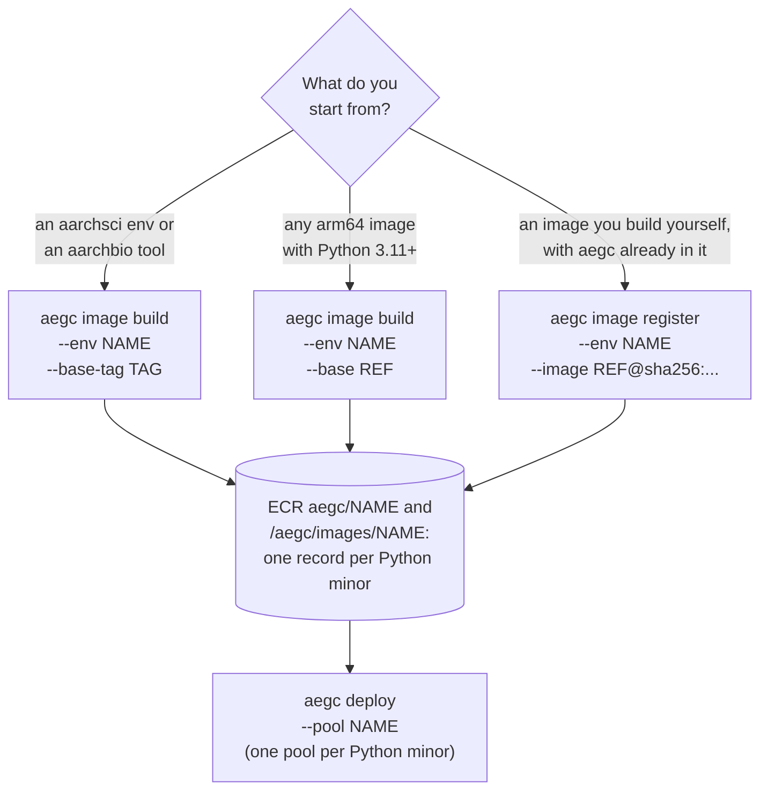

# Build or bring worker images

Workers run your tasks inside a container image, and that image can be your own. Any
`linux/arm64` image with Python 3.11 or later works: aegc adds `globus-compute-endpoint` and its
worker to it, tests the result, pushes it to ECR as `aegc/<env>`, and records it for
`aegc deploy`. Workers then run it by digest. The [aarch.science](https://aarch.science/) and
[aarch.bio](https://aarch.bio/) images are one convenient starting point, not the only one.

There are three ways in, depending on what you start from:



| You have | Use | aegc adds |
|---|---|---|
| An [aarch.science](https://aarch.science/) env or [aarch.bio](https://aarch.bio/) tool | `aegc image build --base-tag` | `globus-compute-endpoint` (from conda-forge) and the aegc worker |
| Any other arm64 image: `python:3.13-slim`, your lab's image, a micromamba image | `aegc image build --base` | the same, with pip or micromamba |
| An image you build and test yourself | `aegc image register` | nothing: it checks your image and copies it |

With `--base` and `register`, the env name (`--env`) is yours to choose. It names the ECR
repository, the image record and the pools, and it's what clients pass as
`user_endpoint_config={"env": ...}`.

## From aarchsci or aarchbio

Run from the root of the aegc source tree (or pass `--project-dir`):

```sh
aegc image build --env geospatial --base-tag 2026.11.13.154112
```

The steps:

1. Build the aegc wheel with `uv build`.
2. Log in to ECR and build `linux/arm64` with `docker buildx`, from
   `<account>.dkr.ecr.<region>.amazonaws.com/aegc-quay/aarchsci/<env>:<base-tag>`, the region's
   pull-through cache of `quay.io/aarchsci/<env>:<base-tag>`.
3. Inside the build: install `globus-compute-endpoint` from conda-forge with micromamba, then fail
   if any package that was already in the image changed version or disappeared, except `click`
   (`globus-compute-endpoint` pins an older one). Then install the aegc wheel, constrained to the
   installed packages, and run `pip check`.
4. Still inside the build: import `execute_task` and the worker, run the image's own
   `/opt/aarchsci/smoke.py` if it has one, and run `aegc-worker selftest`, which pushes a real packed
   task through `execute_task`.
5. Read the image's Python minor version.
6. Create the ECR repository `aegc/<env>` if needed (immutable tags, scan on push, and the
   [lifecycle policy](#old-images-and-in-use-tags)), push, and record the image at
   `/aegc/images/<env>` in SSM Parameter Store, under its Python minor.

`--base-tag` must be an immutable tag (for aarchsci, `YYYY.MM.DD.HHMMSS`); `latest` is refused.
`--source aarchbio` builds from `quay.io/aarchbio/<tool>` instead. aarchbio images don't pin a
Python for worker use yet (gap G4 in
[#16](https://github.com/scttfrdmn/aws-elastic-globus-compute/issues/16)), so check which minor
you got with `aegc image list`.

## From any arm64 image

`--base` takes any `linux/arm64` image with Python 3.11 or later, pinned by digest
(`repo@sha256:...`) or by a tag that never moves. References without a tag, and `latest`, are
refused.

```sh
aegc image build --env myenv --base ghcr.io/my-lab/analysis@sha256:<digest>
```

aegc runs the base once to see what kind it is, then picks a Dockerfile:

- **micromamba/conda bases**, with `/opt/conda/bin/python` and `micromamba` on `PATH`, get the
  same build as aarchsci, from
  [templates/worker/Dockerfile](../../src/aegc/templates/worker/Dockerfile). It expects the
  `mambaorg/micromamba` layout: the user `mambauser` and `/usr/local/bin/_entrypoint.sh`.
- **everything else** gets
  [templates/worker/Dockerfile.pip](../../src/aegc/templates/worker/Dockerfile.pip). It
  pip-installs `globus-compute-endpoint` and the aegc wheel into the base's Python, with every
  package the base already has as a constraint, so nothing you installed changes version. Then it
  runs `pip check`, puts `aegc-worker` on `PATH`, adds a user with uid 57439 (the owner of the
  host's `/scratch`) unless that uid exists, and runs as it. Debian and Ubuntu system Pythons work
  too.

If the base has a package at a version `globus-compute-endpoint` can't use, pip can't resolve the
install and the build fails with pip's conflict report. Change the base, or build the image yourself and
[register it](#register-an-image-you-built).

The pip build clears the base's `ENTRYPOINT`, because workers start with
`docker run <image> aegc-worker run`. Settings made with `ENV` still apply; an entrypoint script
that sets things up doesn't run.

If the base's Python isn't `python3` on `PATH`, name it: `--python /opt/venv/bin/python`. Conda
bases always use `/opt/conda/bin/python`.

The base is pulled from its own registry, not through the ECR cache, so `--direct` makes no
difference; log in to that registry first if it's private. Workers only ever pull the
`aegc/<env>` copy.

### Example: Python 3.13 and numpy

Start from `python:3.13-slim` and add what your tasks import. Look up the current digest so the
base is pinned:

```sh
docker buildx imagetools inspect python:3.13-slim | grep Digest
```

```dockerfile
# Your base: your packages, nothing aegc-specific.
FROM python:3.13-slim@sha256:<digest>
RUN pip install --no-cache-dir numpy==2.5.4
```

```sh
docker buildx build --platform linux/arm64 --load -t numpy-base:2026.11.15 .
aegc image build --env numpy --base numpy-base:2026.11.15
aegc image list --env numpy
```

`aegc image build` adds `globus-compute-endpoint` and the worker without changing numpy, runs the
selftest, pushes `aegc/numpy` and records it for Python 3.13. The base can be a local image, as
here, or one in a registry.

Then deploy a pool for it and submit from Python 3.13:

```sh
aegc deploy e2e --pool numpy:max_vcpus=8
```

```python
from globus_compute_sdk import Executor


def norm(n):
    import numpy as np

    return float(np.linalg.norm(np.arange(n)))


with Executor(
    endpoint_id=ENDPOINT_ID, amqp_port=5671, user_endpoint_config={"env": "numpy"}
) as ex:
    print(ex.submit(norm, 1_000_000).result())
```

A running endpoint picks up the new pool within a minute.

!!! tip "Use a new reference for every change"
    The tag aegc pushes is derived from the base reference, not from its contents. Rebuilding from
    the same reference (say `numpy-base:2026.11.15` after you changed it) with the same aegc code
    finds that tag in ECR and reuses the image pushed before. Give each change to a base a new
    tag, or use digests.

## Register an image you built

If you'd rather build the worker image yourself (your own Dockerfile, CI, a scanner in between),
install aegc and `globus-compute-endpoint` in it and register it. aegc isn't on PyPI, so build the
wheel from the same source tree as the `aegc` you deploy with:

```sh
uv build --wheel --out-dir dist .   # in the aegc source tree; put dist/ next to your Dockerfile
```

```dockerfile
# syntax=docker/dockerfile:1
FROM ghcr.io/my-lab/analysis@sha256:<digest>
USER root
COPY dist/ /tmp/aegc-dist/
RUN python3 -m pip install --no-cache-dir "globus-compute-endpoint==4.21.0" /tmp/aegc-dist/*.whl \
 && python3 -m pip check \
 && rm -rf /tmp/aegc-dist \
 && useradd --create-home --uid 57439 aegc
# Workers run as uid 57439, which owns the host's /scratch, with no wrapper entrypoint.
USER 57439
ENTRYPOINT []
CMD ["aegc-worker", "run"]
```

Build it for arm64, push it to a registry you can pull from, and register it by digest:

```sh
docker buildx build --platform linux/arm64 -t ghcr.io/my-lab/analysis-aegc:2026.11.15 --push .
docker buildx imagetools inspect ghcr.io/my-lab/analysis-aegc:2026.11.15 | grep Digest
aegc image register --env analysis --image ghcr.io/my-lab/analysis-aegc@sha256:<digest>
```

`register` pulls the image for `linux/arm64` and checks that:

- it's pinned: `repo@sha256:...`, or a tag other than `latest`;
- it's arm64 (otherwise `<image> is amd64, not arm64: workers are Graviton`);
- its Python (`python3`, or `--python PATH`) imports aegc 0.2 or later (otherwise
  `<image> has aegc 0.1.0; workers need aegc 0.2 or later`);
- `aegc-worker selftest` passes in it.

Then it reads the Python minor, copies the image into `aegc/<env>` with the tag
`py<M.m>-aegc<version>-r<hash of the reference>`, and records it as kind `registered`. It prints
the pinned `aegc/<env>` image.

`register` runs those checks with its own entrypoint, so some things a worker needs aren't
checked. Workers run `docker run <image> aegc-worker run`, so:

- **`aegc-worker` must be on `PATH`**, in the same Python environment as your packages.
- **The entrypoint must be empty, or run its arguments** (`exec "$@"`), as micromamba's does.
- **Run as uid 57439, or root.** The host's `/scratch` belongs to uid 57439, and the worker keeps
  its heartbeat and task directories there. If it can't write them, its tasks fail and the host
  watchdog terminates the instance.
- **Use the aegc wheel from your current source tree**, as above. Size classes and `aegc.outputs`
  are worker features, and an older wheel inside the image silently lacks them.

## Several Python minors per env

Globus Compute needs the worker's Python minor version to equal the client's. An env can have an
image for each minor you submit from: `/aegc/images/<env>` keeps one record per minor, and building
or registering an image replaces only the record for its own minor.

```sh
aegc image build --env numpy --base numpy-base:py313-2026.11.15   # FROM python:3.13-slim
aegc image build --env numpy --base numpy-base:py314-2026.11.15   # FROM python:3.14-slim
aegc image list --env numpy
```

```
3.13	pip	aegc 0.2.0	123456789012.dkr.ecr.us-west-2.amazonaws.com/aegc/numpy@sha256:...
3.14	pip	aegc 0.2.0	123456789012.dkr.ecr.us-west-2.amazonaws.com/aegc/numpy@sha256:...
```

The columns are the Python minor, the kind (`conda`, `pip` or `registered`), the aegc version in
the image, and the pinned image.

`aegc deploy --pool numpy` then makes one pool per recorded minor, `numpy-py313` and
`numpy-py314`, each with the options given. Each submitter's tasks go to the pool for its own
Python minor, automatically. To deploy just one, name it: `--pool numpy:python=3.13`. A minor
without an image is refused: `aegc: no 'numpy' image for Python 3.12; have 3.13, 3.14`.

Each pool has its own `max_vcpus`, so two minors can run twice the vCPUs of one, and the Spot quota
check counts both. There's no command to drop a minor's record yet; use `python=` to deploy only
the ones you want.

## Use a new image

`aegc deploy` reads `/aegc/images/<env>` and puts the digest in the launch template. A deployment
keeps running the image it was deployed with, so after a build, redeploy:

```sh
aegc image build --env geospatial --base-tag <newer tag>
aegc deploy e2e --pool geospatial
```

The pool keeps its other options. New workers run the new image; running workers keep the old one
until they drain. Running endpoints pick up the redeploy within a minute.

An image for a Python minor the env didn't have adds a pool at the next deploy (for example
`geospatial-py315`), next to the existing one. A pool you stop listing is kept, with a warning;
pass `--prune --yes` to remove it.

## Old images and in-use tags

The repository's lifecycle policy keeps the 10 most recent images, removes untagged images after a
day, and never removes an image that a deployment uses. `aegc deploy` tags each image it pins
`inuse-<d>-<first 12 hex digits of the digest>` (adding a tag to the existing image; tags stay
immutable) and removes the deployment's older `inuse-` tags. A priority-1 lifecycle rule keeps every
image with an `inuse-` tag, however old. `aegc destroy` removes the deployment's tags, and the image
then ages out normally. The policy is re-applied to existing repositories on every build and deploy.

Protected images still count toward the 10, so many deployments on old images leave fewer slots for
new builds. An env's images for every Python minor share one repository, and so share the 10.

## Things to know

- **Tags.** A build is tagged `py<M.m>-gce<v>-aegc<v>-b<base>-w<wheelhash>`, for example
  `py3.14-gce4.21.0-aegc0.2.0-b2026.11.13.154112-w1a2b3c4d`. `<base>` is the aarchsci or aarchbio
  tag, or the first 12 hex digits of the SHA-256 of a `--base` reference. The wheel hash is the
  first 8 hex digits of the SHA-256 of the aegc wheel, so a code change gets a new tag. If the tag
  already exists, the build reuses the pushed image instead of pushing again.
- **Build options.** `--gce-version` sets the `globus-compute-endpoint` version (default 4.21.0;
  keep it compatible with the endpoint's). `--no-push` builds and tests locally and records
  nothing. `--direct` pulls an aarchsci or aarchbio base from quay.io instead of the ECR cache.
- **Env names of at most 34 characters.** The pool name `<env>-py<NNN>` must fit in 40 characters,
  and a [size class](configuration.md#size-classes) adds `-<size>`: with `size=medium`, envs can
  have at most 27. Every aarchsci env fits; the longest, `earth-observation`, gives
  `earth-observation-py314`.
- **Python must match the clients.** The aarchsci images run Python 3.14. For clients on another
  minor, add an image for it, as [above](#several-python-minors-per-env).
- **Old images expire, unless a deployment uses them.** See
  [Old images and in-use tags](#old-images-and-in-use-tags).
- **Rebuild images from before aegc 0.2.** `aegc deploy` refuses them unless given
  `--allow-old-image`: their workers ignore spend limits, `aegc stop` and the lease.
- **Rebuild for new worker features.** [Size classes](configuration.md#size-classes) and
  [`aegc.outputs`](data.md#return-large-outputs) need workers built from this release's code. Older
  workers run one task per vCPU whatever the size class, and have no `aegc.outputs`.
- **Images are big.** Science images are often several GB, which shows in cold-start time and ECR
  storage. The pull-through cache keeps aarchsci and aarchbio pulls in-region.
- **Native arm64 builds.** On Apple Silicon the build is native. Elsewhere buildx needs QEMU, and
  the in-image tests run emulated.
- Repositories and image records stay after `aegc destroy` and `aegc unbootstrap`. Remove them with
  the AWS CLI or console if you no longer need them.
