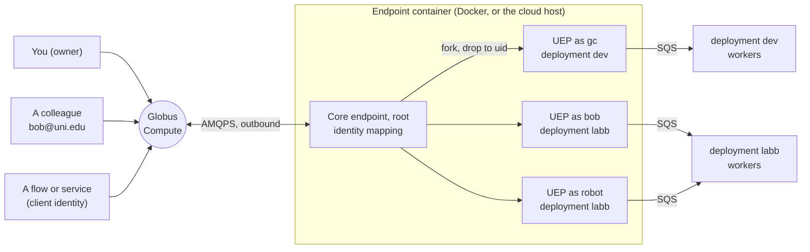

# Share an endpoint (multi-user)

A normal aegc endpoint is **single-user**: it runs as your Globus login and accepts tasks only from
you (and identities linked to yours). A **multi-user** endpoint accepts tasks from other Globus
identities as well, such as a colleague, a second lab, or an automation client. Each one is mapped
to a local user, and each local user has its own deployment and AWS profile.



Globus Compute does the mapping. Since Compute 4.0, identity mapping is a feature of a privileged
**Core Endpoint** (called a multi-user endpoint before 4.18). aegc runs the same endpoint image as
root with a few capabilities. Its template picks each local user's deployment, so a submitter
can't pick another user's deployment.

## When to use it

- **A colleague should submit to your deployment**, or to a deployment of their own on your
  account, without running an endpoint of their own.
- **A flow or service runs as a client identity.** A single-user endpoint accepts only its
  owner. A flow action state with `"RunAs": "Flow"` calls the Compute action provider as the
  flow's own identity, and a service runs as its confidential client (`<client-id>@
  clients.auth.globus.org`). Neither is the owner, so a single-user endpoint refuses their
  tasks. Map the client identity to its own local user and deployment.
- **One endpoint for several labs**, each kept in its own deployment.

Don't use it just for yourself. A single-user endpoint is simpler, and it doesn't run as root.

## Before you start

- **An endpoint image from aegc 0.8.** Run `aegc endpoint build`. The multi-user entrypoint is
  new in 0.8.
- **Your Globus login.** Run `aegc endpoint login` (stored in `aegc-endpoint-home`). The
  multi-user endpoint copies it, and it runs as you: Globus locks an endpoint id to the identity
  that registered it.
- **A deployment for each local user**: `aegc deploy <d> ...` for each deployment you map to.
- **Each submitter's identity**: an identity id, or a username. To find one, use
  `globus get-identities bob@uni.edu`, or ask them to run `globus whoami --linked-identities`.

## Configure it

Use a new endpoint name. An endpoint name runs in one mode only (see
[Switch modes](#switch-modes)). If you leave out your own rule, `configure` refuses, and its
message gives your identity id.

```sh
ep() { aegc endpoint --name shared --deployment dev --env geospatial "$@"; }
ep configure --multi-user --contact-email you@uni.edu \
  --map <your-identity-id>=gc \
  --map bob@uni.edu=bob:labb:labb \
  --map 'abcd1234-0000-4000-8000-00000000c11e@clients.auth.globus.org=robot:labb:labb'
ep start
ep status          # the local endpoint, each local user's processes (then the cloud endpoint)
```

`configure` prints what it wrote:

```
configured shared: deployment dev, region us-west-2, env geospatial
multi-user: 3 rule(s), 3 local user(s)
  bob: deployment labb (us-west-2, profile labb) <- bob@uni.edu
  gc: deployment dev (us-west-2, profile aws) <- 6f0c1e1a-...
  robot: deployment labb (us-west-2, profile labb) <- abcd1234-...@clients.auth.globus.org
restart the endpoint (stop, start) to add new local users; mapping changes alone apply within seconds
```

It runs `globus-compute-endpoint configure --multi-user true --contact-email ...` in the image (as
root, in the volume `aegc-endpoint-mu`), copies your login there from `aegc-endpoint-home`, and
writes:

- `identity_mapping_config.json`: one `expression_identity_mapping#1.0.0` document, with the
  rules in `--map` order (mode 600);
- `user_config_template.yaml.j2`: aegc's template, with a table from local user to deployment,
  region and AWS profile;
- `config.yaml`: `email`, `identity_mapping_config_path`, `amqp_port: 5671`, `public: false`, and
  `allowed_functions` if you pass `--allow-function`;
- `aegc_local_users` and `aegc_multi_user.json`: the local users and the rules, for `start`,
  `status` and `deploy`.

Run `configure` again with the full set of `--map` rules to change them. The core endpoint reloads
a changed identity mapping by itself. It applies a changed table to new user endpoint processes.
Restart the endpoint to add a local user.

### The mapping syntax

```
--map <identity>=<local-user>[:<deployment>[:<aws-profile>[:<region>]]]
```

| `<identity>` | Matches | Example |
|---|---|---|
| An identity id (UUID) | That identity, by `{id}` | `6f0c1e1a-...=gc` |
| A username | That username, by `{username}`, ignoring case | `bob@uni.edu=bob` |
| A client's username | A confidential client, or a flow's own identity | `<client-id>@clients.auth.globus.org=robot` |
| A pattern (with `* ? \| ( ) \`) | Usernames matching Globus' reduced regular expressions, anchored at both ends, ignoring case | `'.*@lab-a\.uni\.edu=alice'` |

- **Globus checks every identity linked to the submitter's account.** Rules are tried in order,
  and the first match wins.
- **Defaults.** An empty `deployment`, `aws-profile` or `region` means the endpoint's
  `--deployment`, `--profile` (or `AWS_PROFILE`) and `--region`.
- **One row per local user.** Several identities can map to one local user, but all their rules
  must give it the same deployment, profile and region.
- **Local users** are 1 to 32 characters of `[a-z0-9_-]`, starting with a letter or `_`. `gc` is
  the image's own user (uid 1000). Others get uids from 2001 up, in name order. aegc refuses
  `root` and the image's system accounts, and Compute itself refuses to run a user endpoint as
  the core endpoint's uid.
- **Patterns** use Globus' language: `.` matches any character, so write `\.` for a dot. aegc
  refuses what Globus' mapper would refuse: a leading `*` or `?`, lazy `*?` or `??`, and other
  escapes. It also refuses a pattern that matches every identity, such as `.*` or `(.*)@(.*)`.

**You must be mapped too.** `configure` reads your identity id from your login and refuses with
`no --map rule admits the endpoint's owner (...)` unless a rule admits you. If the rule that admits
you is by username, pass `--owner-username you@uni.edu` so aegc can check it. Use
`--allow-unmapped-owner` to skip the check. Without your own rule you can't submit, and `aegc
endpoint test` won't work.

## What's isolated, and what isn't

**Each local user is one trust domain.** Its row in the template decides its deployment, region
and AWS profile. The template's schema doesn't accept `deployment`, `region` or `aws_profile` in
`user_endpoint_config`, so a submitter can't choose another user's row. A local user without a
row can't start a user endpoint process: the template doesn't render.

What's separate for each local user:

- **Its user endpoint processes (UEPs).** The core endpoint forks, drops to the user's uid and
  gid, drops all capabilities and sets `PR_SET_NO_NEW_PRIVS`, then runs the UEP, where AWSEngine
  runs. aegc doesn't configure PAM, so Compute always takes this path.
- **Its home**, `/home/<user>` (mode 700, in the volume `aegc-endpoint-mu-home`). Its UEPs keep
  their state and logs there. Its copy of `~/.aws` is there too.
- **Its deployment**: task queues, workers, task role, grants and spend limits, as for any
  deployment. Tasks run on that deployment's workers, never in the endpoint container. See
  [Task isolation](../concepts/security.md#task-isolation).

What isn't:

- **One container (or host), one root core endpoint.** It holds your Globus login and the
  identity mapping, readable only by root. A flaw in Globus Compute's core endpoint or in the
  container runtime would expose every user's work.
- **Each local user's `~/.aws` is a full copy of yours** (on your machine). The template, not file
  permissions, decides which profile a user's UEP uses. Only Globus Compute and AWSEngine run as
  these users, never task code. So any user's UEP has your credentials for every profile. Use
  profiles limited to the [operator](../reference/iam.md#operator) policy for each deployment.
  Per-lab cross-account roles are
  [#63](https://github.com/scttfrdmn/aws-elastic-globus-compute/issues/63).
- **On the cloud endpoint, every mapped user shares the host's role.** That role can operate only
  the host's deployment (see [The cloud endpoint](#the-cloud-endpoint)).
- **The endpoint is yours.** Globus shows it as your endpoint with your contact email. You can
  see every user's UEP logs, through `aegc endpoint logs`.

## Admit a colleague

1. Find their identity: `globus get-identities bob@uni.edu` gives the id. A username rule also
   matches their linked identities.
2. Give them a deployment, or share one: `aegc deploy labb ...`. A profile for that deployment
   with the operator policy is enough.
3. Add their rule to the full set, and restart for a new local user:

    ```sh
    ep configure --multi-user --contact-email you@uni.edu --map <you>=gc \
      --map bob@uni.edu=bob:labb:labb
    ep stop && ep start
    ```

4. They submit with your endpoint id, from their own login:

    ```python
    from globus_compute_sdk import Executor

    with Executor(endpoint_id="<endpoint id>", user_endpoint_config={"env": "geospatial"}) as ex:
        print(ex.submit(pow, 2, 10).result())
    ```

Their tasks run on `labb`, with `labb`'s pools, grants and spend limits, whatever they put in
`user_endpoint_config`.

## Admit an automation client identity

Map the client's identity: either its username, `<client-id>@clients.auth.globus.org`, or its
identity id, which is the same UUID as its client id.

- **A flow with `"RunAs": "Flow"`.** The flow's identity is `<flow-id>@clients.auth.globus.org`.
  Hard-code the endpoint id and function id in the flow, and set
  [`allowed_functions`](flows.md#allow-only-your-functions).
- **A service with a confidential client** (`GLOBUS_COMPUTE_CLIENT_ID` and
  `GLOBUS_COMPUTE_CLIENT_SECRET` in the SDK).

Give the client its own local user and deployment, say `robot` and `labb-auto`. Then its spend
limits, grants and lease are its own, and a leaked client secret reaches only that deployment.

## Docker flags

`aegc endpoint start` runs the container as root with only six capabilities:

```sh
docker run -d --name aegc-endpoint-shared --restart unless-stopped \
  --user 0 --security-opt no-new-privileges --cap-drop ALL \
  --cap-add SETUID --cap-add SETGID --cap-add KILL \
  --cap-add CHOWN --cap-add DAC_OVERRIDE --cap-add FOWNER \
  -v aegc-endpoint-mu:/root/.globus_compute -v aegc-endpoint-mu-home:/home \
  -v ~/.aws:/etc/aegc/aws:ro -e AWS_REGION=... -e AWS_DEFAULT_REGION=... \
  -e GC_ENDPOINT=shared -e GC_MULTI_USER=1 aegc-endpoint
```

| Flag | Why |
|---|---|
| `--user 0` | Compute maps identities only when the core endpoint can change uid |
| `SETUID`, `SETGID` | To become each mapped user (`setresgid`, `initgroups`, `setresuid`) |
| `KILL` | To stop user endpoint processes, which run as other uids |
| `CHOWN`, `FOWNER` | To create each user's home and own their copy of `~/.aws` |
| `DAC_OVERRIDE` | To read `~/.aws` (owned by your uid on Linux hosts) and the users' log files |
| `no-new-privileges` | No setuid binaries in the container. Compute sets the same flag again in each UEP |

There's no `--privileged`, and no other capability: Docker's default set also has `NET_RAW`,
`MKNOD`, `SYS_CHROOT`, `SETPCAP`, `SETFCAP`, `FSETID`, `NET_BIND_SERVICE` and `AUDIT_WRITE`, and the endpoint
needs none of them. Docker's default seccomp profile stays on. Without `KILL`, root in the container
can't signal another uid's process. Without `DAC_OVERRIDE`, it can't read a user's mode-600 files.

At start the entrypoint creates the local users and their homes, copies `~/.aws` into each home,
and copies it again within a minute of a change on your machine (after `aws sso login`, say).
Then it runs `globus-compute-endpoint start <name> --log-to-console`.

## Check it

- **`aegc endpoint status`** shows the local endpoint and each local user's processes, then the
  cloud endpoint:

    ```
    local endpoint shared (multi-user): running (aegc-endpoint-shared)
      bob (labb, profile labb): 3 process(es)
        212 340s globus-compute-endpoint ...
      gc (dev, profile aws): 0 process(es)
    ```

- **`aegc endpoint logs`** follows the core endpoint, with each UEP's log copied in as
  `[uep <user>]`.
- **`aegc endpoint render --as bob --options '{"env": "climate"}'`** renders the running
  endpoint's template as `bob`'s UEP would get it. It runs `globus-compute-endpoint
  render-user-config` as `bob` in the container. Use it after each `configure`.

## The cloud endpoint

`aegc endpoint deploy` moves a multi-user endpoint to the cloud too: same endpoint id, same rules,
one place at a time. It finds the mode from the local endpoint's configuration.

- **The identity mapping goes in the login secret.** The Globus identities you admit aren't in
  the launch template's user data. The host writes the mapping to a root-only file at boot.
- **Root container, same flags.** The host runs the container with the flags above. The login is
  in `/var/lib/aegc-endpoint/core` (root, mode 700) and the users' homes are in
  `/var/lib/aegc-endpoint/home`. `aegc evaluate` runs as root with no capabilities, to read the
  login.
- **One deployment, the host's role.** Every mapped user runs with the endpoint role, which can
  operate only the host's deployment. `deploy` refuses rules that name another deployment, another
  region or an AWS profile: `the cloud endpoint's mapped users all use deployment <d> in <region>
  with the host's role ...`. On the cloud, multi-user admits more submitters to one deployment. It
  doesn't separate them into trust domains. Per-user roles would need a later issue, and per-lab
  accounts are [#63](https://github.com/scttfrdmn/aws-elastic-globus-compute/issues/63).
- **Changing the rules.** Run `configure` locally, then `deploy` again. The secret changes, so the
  host is replaced.

## Allowed functions and authentication policies

- **`--allow-function`** works as on a single-user endpoint: the list goes in the core
  endpoint's `config.yaml`. Globus refuses other functions for every submitter, and each UEP
  checks again. See [Allow only your functions](flows.md#allow-only-your-functions).
- **Authentication policies** (allowed domains, recent login, high assurance) are Globus' own
  controls on who may reach the endpoint at all. aegc doesn't create them. Create one with the
  Globus Auth API or SDK, add `authentication_policy: <policy id>` to the core endpoint's
  `config.yaml` (in the volume `aegc-endpoint-mu`), and restart the endpoint. See Globus
  Compute's
  [Security Posture](https://globus-compute.readthedocs.io/en/latest/endpoints/security_posture.html)
  and [Multi-User Endpoints](https://globus-compute.readthedocs.io/en/latest/endpoints/multi_user.html).
  Note that aegc's `configure` rewrites `email`, `identity_mapping_config_path`, `amqp_port` and
  `public`, but leaves other keys alone. `AWSEngine` refuses to run on a high-assurance endpoint.

## Switch modes

An endpoint name is either single-user (in `aegc-endpoint-home`) or multi-user (in
`aegc-endpoint-mu`). `configure --multi-user` refuses a name that's already single-user
(`<name> is a single-user endpoint ...; use another --name`), and a plain `configure` refuses a
multi-user name. The multi-user endpoint registers as a new endpoint, with a new id, on its first
start. Clients and flows need that id.

## Verify it live

The image, `configure`, the identity mapping, the privilege drop and the per-user templates have
been checked in Docker without Globus (see the [changelog](../../CHANGELOG.md)). These steps
need real logins:

1. `ep configure --multi-user ... && ep start`: the endpoint registers, and `ep id` prints a new
   id. The Globus web app lists it under your endpoints, with your contact email.
2. `ep test`: your own task runs, as `gc`, on `dev`.
3. A second identity submits (step 4 of [Admit a colleague](#admit-a-colleague)). `ep status`
   shows a UEP for `bob`. Workers on `labb` scale up, and the result comes back.
4. An unmapped identity submits and is refused (`Identity failed to map to a local user name`
   in `ep logs`).
5. `"RunAs": "Flow"` in a flow's compute step, with the flow's identity mapped, runs on that
   user's deployment.
6. `ep deploy --stop-local` with single-deployment rules: steps 2 to 4 again on the cloud host.
