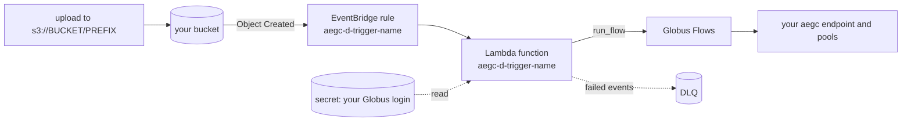

# Start a flow when a file lands in S3

A trigger starts a Globus flow each time an object is created in one of your S3 buckets, under a
key prefix (and suffix) you choose. Globus has no event source of its own: the Compute docs say
there's "no direct analog to Lambda's event-source mappings", and they point to watcher scripts.
A trigger is the AWS side of that, with nothing to keep running.

Triggers came with v0.8 ([#83](https://github.com/scttfrdmn/aws-elastic-globus-compute/issues/83)).



The function starts the flow **as you**: it uses your own Globus login, stored in Secrets Manager
and readable by that function only. The flow then does the work (Compute steps on your aegc
endpoint, Transfer steps and so on) with your identity, as if you had started it by hand. The
function itself can't read your bucket.

## What you need

- A deployed deployment (`aegc deploy`), in the bucket's region.
- The flow's id, and a flow you may run.
- **A Globus native app client id of your own.** Register one at
  [app.globus.org/settings/developers](https://app.globus.org/settings/developers): add a project,
  then "Register a thick client or script that will be installed and run by users on their
  devices". It's free and takes a minute. globus-sdk's `UserApp` needs a client id, and aegc
  doesn't borrow another app's (Globus Compute's or the Globus CLI's): you'd be consenting to
  that app, and its owner controls it. Pass it as `--client-id` or set `AEGC_GLOBUS_CLIENT_ID`.
- The [lambda-deployer policy](../reference/iam.md#lambda-deployer) next to the deployer policy,
  and `s3:GetBucketNotification` / `s3:PutBucketNotification` on your bucket (the policy allows
  them on any bucket; your bucket's own policy decides).

## Log in

```console
$ aegc trigger login dev --name uploads --flow FLOW_ID --client-id CLIENT_ID
```

This prints a Globus URL; open it, consent to running the flow, and paste the code back. aegc
stores the tokens (the refresh token for the flow's scope, plus Globus Auth's) in the secret
`aegc-dev-trigger-uploads`. Nothing is written locally. The secret's resource policy denies
`GetSecretValue` to every principal but the trigger's function role, whatever else IAM allows in
the account; aegc's own deployer policies never read it.

Globus refresh tokens don't rotate. They stay valid while they're used and expire after six months
unused, or when you revoke the consent in Globus. Log in again then (and after changing the flow
of a trigger).

## Create the trigger

```console
$ aegc trigger create dev --name uploads --flow FLOW_ID --bucket my-lab-data \
    --prefix cohort/requests/ --suffix .json \
    --input '{"regions_uri": "s3://{bucket}/{key}", "bytes": "{size}"}' --dry-run
$ aegc trigger create dev --name uploads ...   # the same, without --dry-run
```

`--input` is the flow's input, a JSON object. String values may use `{bucket}`, `{key}`, `{size}`
and `{etag}` of the new object; a value that is just `"{size}"` becomes a number. Each run is
labelled `s3:<key>` (the key's end, if it's long) and tagged `aegc-trigger`, `aegc:<deployment>`
and `trigger:<name>`, so `globus flows run list` finds them.

Create builds the function's package (globus-sdk and its dependencies as arm64 wheels for Python
3.13, with `pip` or `uv`; about 5 MB), so it needs network access to PyPI. `--package ZIP` uses one
you built before. Running create again updates the trigger in place; a new `--prefix` or `--input`
changes the rule or the function, and a trigger whose rule is disabled stays disabled.

What it makes, all named `aegc-<d>-trigger-<name>` and [tagged](../reference/resources.md#tags):

| Resource | Notes |
|---|---|
| EventBridge rule | S3 `Object Created` for the bucket; the prefix and suffix are ANDed |
| Lambda function | zip, python3.13, arm64, 256 MB, 60 s, reserved concurrency 2, logs to `/aegc/<d>` |
| Dead-letter queue `…-dlq` | the function's on-failure destination, after 2 async retries (events up to 6 h old) |
| IAM role `…-<region>` | under `/aegc/`; reads its secret, writes its logs, sends to its DLQ. No S3 access |
| Lambda permission | `events.amazonaws.com` may invoke the function for this rule only |
| Secret | your login (from `trigger login`) |
| SSM parameter `/aegc/<d>/triggers/<name>` | the trigger's spec |

**Your bucket.** aegc turns on the bucket's EventBridge delivery (`EventBridgeConfiguration`) with
a read-merge: it reads the bucket's notification configuration and writes it back with EventBridge
added, so your existing Lambda, SQS and SNS notifications are kept. aegc doesn't own the bucket,
so delete and destroy leave EventBridge delivery on (reported as `kept`). EventBridge delivery
costs nothing by itself; turn it off in the S3 console if nothing else uses it.

## Watch it

```console
$ aegc trigger list dev
uploads          ENABLED   s3://my-lab-data/cohort/requests/*.json -> flow FLOW_ID [3 run(s), 0 error(s) in 24 h; 0 in the DLQ]
```

The function logs one JSON line per object to `/aegc/<d>`: `run_started` with the run id, or
`run_failed` with the error's type and message (never a token). A failed start raises, so Lambda
retries it twice; then the event goes to the DLQ, where you can read it with
`aws sqs receive-message`.

## Freezing and spend

Triggers follow the deployment's state, as Lambda pools do: `aegc stop`, a tripped cap and the
lease or TTL disable every trigger rule (the lease through a `lease-trigger-<name>` schedule), and
`aegc resume` or `aegc limits --resume` enable them. The cloud endpoint's evaluator makes the rules
follow the state every 5 minutes. A frozen rule drops events: objects uploaded while it's disabled
don't start flows later.

A trigger costs very little by itself: a 256 MB function for about a second per object, and
EventBridge doesn't charge for AWS service events on the default event bus. The flows it starts run on your pools, under your
deployment's limits.

## Delete a trigger

```console
$ aegc trigger delete dev --name uploads          # dry run
$ aegc trigger delete dev --name uploads --yes
```

This deletes the rule, the function (and its permission), the role, the DLQ, the stored login and
the spec, each only if its name and tags say aegc made it for the deployment, and removes its
lease schedules. `aegc destroy` deletes every trigger of the deployment, finding them by name and
tags; without the lambda-deployer policy it reports them as remaining.
