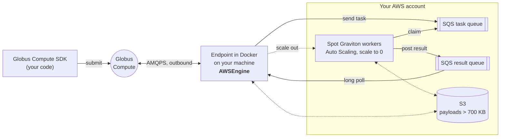

# aws-elastic-globus-compute

`AWSEngine` is a [Globus Compute](https://www.globus.org/compute) endpoint engine that runs tasks on
ephemeral AWS capacity. The package and CLI are called `aegc`.

Tasks go onto an SQS queue. Graviton EC2 workers pull them, run them inside arm64 science containers
on stock AMIs, and post the results back. When the queue is empty the workers terminate themselves,
and each Auto Scaling group returns to zero.

- **Every connection is outbound.** The endpoint talks to Globus over AMQPS and to AWS APIs over
  HTTPS. Workers talk to AWS APIs. Nothing connects in to the laptop, and the workers' security group
  has no ingress rules. The endpoint can also
  [run in the cloud](how-to/cloud-endpoint.md), on a small instance with the same endpoint id.
- **Containers on stock AMIs.** Worker images are thin layers over any arm64 image with Python
  3.11 or later, such as the environments from [aarch.science](https://aarch.science/) and
  [aarch.bio](https://aarch.bio/) or your own, with `globus-compute-endpoint` and the aegc worker
  added. Images are pinned by digest. See [Build or bring worker images](how-to/images.md).
- **Short tasks on Lambda, too.** A pool can be a Lambda function running the same image,
  for tasks of seconds to minutes that shouldn't wait for a worker to boot. See
  [Run short tasks on Lambda](how-to/lambda-pools.md).
- **Managed with boto3.** No CloudFormation. Every resource is tagged when it's created, and aegc
  only deletes resources that carry its tags. Destructive commands are dry runs unless you pass
  `--yes`.

It replaces the HTEX-based setup from
[aws-elastic-parsl](https://github.com/scttfrdmn/aws-elastic-parsl). HTEX workers connect in to the
submit host, which needs tunnels or exposed ports.

!!! note "Status"
    An early 0.x release: v0.7.0 adds [Lambda pools](how-to/lambda-pools.md) for short tasks to
    v0.6.0's [cloud-hosted endpoint](how-to/cloud-endpoint.md) with an offline alarm and
    cloud-side spend checks, [other regions](how-to/operations.md#other-regions), measured
    [tutorials](tutorials/index.md), and v0.4.0's
    [task isolation](concepts/security.md#task-isolation),
    [logs, metrics and provenance](how-to/observability.md) and
    [Globus Flows and Timers](how-to/flows.md). Expect more changes before
    later 0.x versions.
    Work is tracked in the repository's
    [issues](https://github.com/scttfrdmn/aws-elastic-globus-compute/issues) and
    [milestones](https://github.com/scttfrdmn/aws-elastic-globus-compute/milestones).

## Where to start

- **[Quickstart](quickstart.md):** bootstrap a region, build one worker image, deploy a pool, and run
  tasks through a laptop endpoint, then tear it down.
- **[Tutorials](tutorials/index.md):** real workloads, each with what it measured.
- **[When to use aegc](concepts/when-to-use.md):** what it's good at, and its limits.
- **[Architecture](concepts/architecture.md):** how a task travels from the SDK to a worker and back.

The site is organised into tutorials (worked examples), concepts (how it works and why), how-to
guides (tasks you'll do), and reference (exact commands, keys, limits, policies and resources).

!!! info "Tutorials"
    [Worked, measured tutorials](tutorials/index.md): Sentinel-2 NDVI from a notebook to a
    nightly flow, slicing 1000 Genomes in us-east-1, a Spot sweep under FIS interruptions, and one
    flow across a laptop endpoint and aegc. More are proposed in
    [#16](https://github.com/scttfrdmn/aws-elastic-globus-compute/issues/16) and
    [#65](https://github.com/scttfrdmn/aws-elastic-globus-compute/issues/65).
