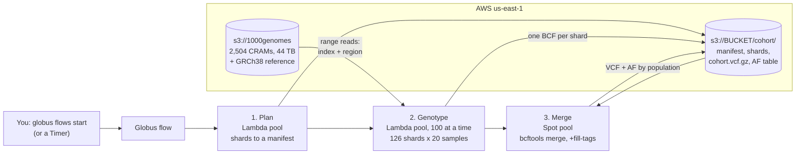

# Genotype a gene across 1000 Genomes: a flow on Lambda and Spot

The 1000 Genomes high-coverage collection is 2,504 whole genomes as CRAM files, about 17.5 GB
each and **44 TB** in all, public in `s3://1000genomes` in us-east-1. A question about one gene in
every sample doesn't need any of them whole. You'll build a Globus flow that genotypes a region
in all 2,504 samples at once, on a Lambda pool, then merges the calls and computes allele
frequencies by population on a Spot pool, and writes the answer to your bucket.

The gene is **APOL1**. Two variants in it, G1 and G2, protect against African sleeping sickness and
raise the risk of kidney disease; they're common in people of recent African ancestry and nearly
absent elsewhere, so the result is easy to check against the literature.

**What it shows:**

- **One pipeline, two backends, each where it fits.** Genotyping is 2,504 independent jobs of a few
  seconds each, reading a few MB: a Lambda pool runs 100 at a time with nothing to boot or leave
  idle. The merge is one job that wants several cores: a Spot pool.
- **Bytes read vs the data's size.** htslib reads each CRAM through its index and the reference
  through its `.fai`, so the whole cohort costs about 26 GB of reads, 0.06% of it, and none of it
  leaves the region.
- **A flow that runs it end to end**, from a laptop or a Timer, with three steps of Globus Compute
  on one aegc endpoint, and what a flow's 200 KB state limit means for fan-out.
- **Real data has gaps.** Two of the 2,504 CRAM indexes are empty files, and three sample names in
  the collection's index end in a space. The tasks report such samples and carry on.



## Before you start

- **The [quickstart](../quickstart.md), once**: its endpoint image (`aegc endpoint build`) and your
  Globus login. Run the commands from the root of the aegc source tree, with its `.venv`
  (Python 3.14) active, and the [Globus CLI](https://docs.globus.org/cli/) installed.
- **The genomics image in us-east-1**, from
  [Slice before you ship](genomics-slice.md): steps 1 and 2 there (bootstrap us-east-1, build
  `genomics`), with aegc 0.7 or later, which Lambda pools need.
- **Lambda concurrency:** the genotype step runs 100 functions at once. Check the account's limit
  with `aws lambda get-account-settings --region us-east-1` (`AccountLimit.ConcurrentExecutions`,
  1,000 by default); with less, lower `concurrency=` below.
- **The [lambda-deployer](../reference/iam.md#lambda-deployer) policy** with the deployer policy.
- **A bucket of yours in us-east-1** for the outputs:

    ```sh
    export AWS_DEFAULT_REGION=us-east-1 BUCKET=<your us-east-1 bucket>
    ```

- **Several Globus identities?** If you use a Globus CLI profile for aegc work, set it for every
  `globus` command here (for example `export GLOBUS_PROFILE=aegc`), so the flow, its consent and
  its runs belong to the identity that owns the endpoint.

**Cost.** About $0.17 a run: the genotype step is about 100 Lambda-minutes at 2 GB ($0.16); the
merge is one Spot worker for about a minute plus its 5 idle minutes (half a cent). The
outputs are about 70 MB in your bucket. Globus Flows runs on a free tier for one flow.

## Steps

### 1. Deploy a Lambda pool and a Spot pool

```sh
aegc --region us-east-1 deploy cohort \
  --pool genomics:lambda,memory=2048,timeout=900,concurrency=100 \
  --pool genomics:max_vcpus=16,vcpu=2-8 \
  --grant read=s3://$BUCKET/cohort/ --grant write=s3://$BUCKET/cohort/ \
  --grant read=s3://1000genomes/1000G_2504_high_coverage/data/ \
  --grant read=s3://1000genomes/technical/reference/GRCh38_reference_genome/ \
  --max-usd-day 10 --ttl 8h
```

That makes `genomics-py314-lambda` (a function of 2 GB, one vCPU's worth, at most 100 running at
once) and `genomics-py314` (Spot workers of 2 to 8 vCPUs, 16 vCPUs at most). Deploy prints a note
that Lambda pools aren't isolated: their tasks run with the pool's function role, which is fine
here, where all the code is yours.

The two `1000genomes` grants are for the Lambda pool. The bucket is public, but Lambda hands tasks
the function role's credentials in environment variables, so htslib signs its requests, and IAM
refuses a signed request to another account's bucket that the role doesn't allow
(`Failed to open FASTA index ...: Permission denied`). On EC2 pools htslib finds no credentials it
reads and asks anonymously, which is why [Slice before you ship](genomics-slice.md) needs no
grant.

### 2. Start an endpoint for it

```sh
ep() { aegc --region us-east-1 endpoint --name aegc-cohort --deployment cohort --env genomics "$@"; }
ep configure
ep start       # prints: started aegc-endpoint-aegc-cohort; endpoint id <uuid>
export ENDPOINT_ID=<uuid>
```

### 3. Try it from the SDK

Before the flow, run the same three steps from Python, on the first 20 samples:

```sh
python examples/cohort-genotype/run_cohort.py --endpoint $ENDPOINT_ID \
  --out s3://$BUCKET/cohort/try/ --limit 20
```

It plans here (writing the manifest to `--out`), sends one `genotype` task per shard of 20 samples
to the Lambda pool, then `merge` to the Spot pool, and prints a summary: samples, variant sites,
bytes read, wall times. Without `--limit` it runs all 2,504. `--genotype-pool genomics-py314` runs
the genotype step on Spot instead, for comparison.

### 4. Register the steps and create the flow

```sh
python examples/cohort-genotype/register_cohort.py   # prints three function ids
globus flows create "aegc cohort genotype" examples/cohort-genotype/cohort.json
export FLOW_ID=<flow id>
globus login --flow $FLOW_ID          # consent to the flow's scopes, once
```

Copy [examples/cohort-genotype/input.json](../../examples/cohort-genotype/input.json) to
`~/aegc-cohort-input.json` and fill in your endpoint id, the three function ids and your bucket.

### 5. Run the flow

```sh
globus flows start $FLOW_ID --label apol1 --input ~/aegc-cohort-input.json
globus flows run show <run id>
globus flows run show-logs <run id>   # when each step started and finished
```

Then read the answer:

```sh
aws s3 cp s3://$BUCKET/cohort/flow/af_by_superpop.tsv - \
  | awk -F'\t' 'NR==1 || $2==36265860 || $2==36265988 || $2==36265995'
```

Those positions are G1 (rs73885319, A>G at 36,265,860; rs60910145, T>G at 36,265,988, which travels
with it) and G2 (rs71785313, a 6-bp deletion at 36,265,995). To run it nightly or weekly, add a
Globus Timer for the flow as in the
[NDVI tutorial](sentinel2-ndvi.md#4-run-it-every-night).

### The code

[examples/cohort-genotype/cohort_tasks.py](../../examples/cohort-genotype/cohort_tasks.py) has the
three functions; each imports what it needs inside, so Globus Compute ships them as source text.

- **`plan(region, out_prefix, genotype_function, per_shard=20)`** reads the collection's
  sequence index (2,504 samples, each with its run, CRAM path and population), cuts the samples
  into shards, writes them as `manifest.json` to your bucket, and returns one task per shard:
  `{"function_id": ..., "kwargs": {"manifest": ..., "shard": n}}`. The flow passes that list
  straight to the next step's `tasks`.
- **`genotype(manifest, shard)`** runs, for each of its samples,
  `bcftools mpileup -q 20 -Q 20 -f <reference> -r <region> <cram>`, then `bcftools call -m` at
  every site (reference calls too, so the merge can tell "reference" from "not called"), and sets
  genotypes with depth under 8 or genotype quality under 20 to missing. It merges its samples into
  one BCF, writes it to `shards/`, and returns a few numbers: the BCF's URI, samples done and
  failed, bytes read (the `rchar` of each `bcftools` process) and seconds.
- **`merge(*shards, manifest)`** downloads the shard BCFs, merges them, adds `AC`, `AN` and `AF`
  overall and per super-population with `bcftools +fill-tags -S`, keeps variant sites called in at
  least 90% of samples, and writes `cohort.vcf.gz` and `af_by_superpop.tsv`.

[cohort.json](../../examples/cohort-genotype/cohort.json) is the flow: three Compute actions on
one endpoint. `user_endpoint_config` picks the pool for each step, and the Python version:
Globus Flows doesn't send the submitter's, so the flow says `python: 3.14`.

**Why a manifest?** A flow's whole state (its input and every step's result) must stay under
[200 KB](https://docs.globus.org/api/flows/limits/). Returning the sample lists from `plan`
(302 KB for 2,504 samples) failed the first live run with `PayloadTooLarge`, so the lists travel
in S3, and each step's result stays small: about 21 KB of tasks from `plan` and 24 KB of shard
summaries from `genotype`.

!!! abstract "Results"
    Measured on 2026-11-24 in us-east-1, region `chr22:36253000-36268000` (APOL1, 15 kb), image
    `genomics` (Debian's bcftools 1.21 over `python:3.14-slim`, aegc 0.7.0), with the Spot pool
    at zero when the flow started.

    **The flow, end to end:**

    | Step | Pool | Time |
    |---|---|---|
    | Plan | Lambda | 7 s |
    | Genotype: 126 shards of 20 samples | Lambda, 100 at once | **2 min 22 s** (shards of 10–53 s, 46 s on average) |
    | Merge | Spot, from zero | 55 s (22 s of it the merge; the rest a worker's boot) |
    | **Whole flow** | | **3 min 24 s** |

    | Measure | Value |
    |---|---|
    | Samples genotyped | **2,502** of 2,504 (HG00619 and HG00620 have empty CRAM indexes) |
    | Bytes read | **25.8 GB** of 44 TB (0.06%), about 10 MB per sample |
    | Lambda work | 6,000 s in 127 invocations, 85 execution environments (66.7 s of init) |
    | Cost (`aegc cost`) | **$0.17** a run: $0.163 for the Lambda steps, about $0.005 for the Spot merge (a `c9g.large` for about 7 minutes, boot and idle included) |
    | Variant sites | 831 in 15 kb, called in at least 90% of samples |

    **The answer:**

    | Variant | Position | All | AFR | AMR | EAS | EUR | SAS |
    |---|---|---|---|---|---|---|---|
    | G1 (rs73885319, A>G) | 36,265,860 | 0.070 | **0.259** | 0.009 | 0 | 0 | 0 |
    | G1 (rs60910145, T>G) | 36,265,988 | 0.070 | **0.259** | 0.009 | 0 | 0 | 0 |
    | G2 (rs71785313, 6-bp deletion) | 36,265,995 | 0.035 | **0.129** | 0.009 | 0 | 0 | 0 |

    That's what's known: G1 and G2 at about 26% and 13% in African-ancestry samples, and nearly
    absent elsewhere. On four samples the calls matched the collection's own GATK calls site for
    site.

    **The genotype step on Spot instead**, from the SDK script with shards of 10 samples (251
    shards): **6 min 14 s** on the Spot pool (16 vCPUs, its first workers still up from an earlier
    merge) against **1 min 26 s** on the Lambda pool, for about the same compute (5,222 s of task
    time on Spot, 5,772 s on Lambda). Lambda's lead is its concurrency: 100 at once without a
    capacity plan or a vCPU quota, where the Spot pool had 16. A bigger Spot pool would close the
    gap, at the price of booting more workers and leaving them idle afterwards.

## What to look at

- `globus flows run show-logs <run id>` for each step's start and end.
- `aegc --region us-east-1 metrics cohort` for the Lambda pool's concurrent executions and
  throttles, and the Spot pool's tasks and workers.
- `aegc --region us-east-1 cost cohort --by pool`: Lambda from Lambda's own metrics, Spot from the
  cost ledger.
- A shard's log lines: `aegc --region us-east-1 provenance cohort <task id>`, or the
  `/aegc/cohort` log group. A sample that failed is printed there with htslib's error.

## Teardown

```sh
ep stop
globus flows delete $FLOW_ID
aegc --region us-east-1 destroy cohort            # dry run
aegc --region us-east-1 destroy cohort --yes
aws s3 rm s3://$BUCKET/cohort/ --recursive
```

Then, if you're done with us-east-1, the image and the bootstrap as in
[Slice before you ship](genomics-slice.md#teardown).
