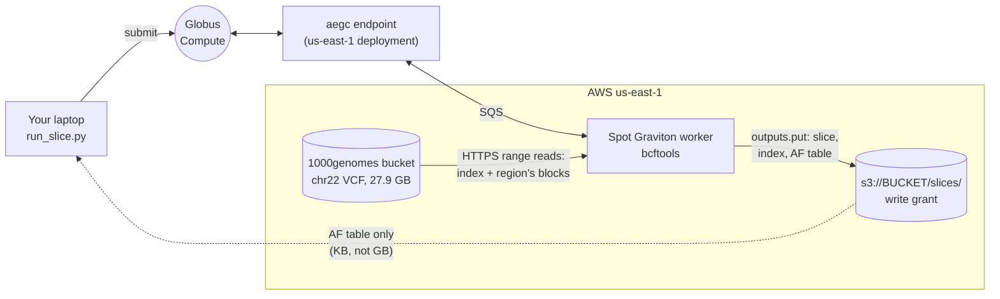

# Slice before you ship: 1000 Genomes

The 1000 Genomes high-coverage call set keeps chromosome 22 for all 3,202 samples in one
bgzipped VCF of 27.9 GB, in us-east-1. If you want one megabase of it, you don't need the other
27.2 GB. You'll run `bcftools` on a Spot worker in us-east-1, next to the data, read just the
region you want over HTTPS, compute allele frequencies, and bring home only the answer.

**What it shows:**

- **Bytes shipped vs the whole file.** The task reads the index and the compressed blocks for the
  region; the slice stays in your bucket, and your laptop downloads a small allele-frequency
  table.
- **Egress avoided.** Downloading the whole file would be 26 GiB over your link. The 1000 Genomes
  bucket is in the [AWS Open Data](https://registry.opendata.aws/1000-genomes/) program, so that
  download wouldn't be billed to you, but the same file in a bucket you pay for would cost about
  $2.34 in internet egress at $0.09 per GB (AWS counts a GB as 2^30 bytes; it's $2.51 per decimal
  GB). Reading it from a worker in the same region costs nothing.
- **Wall time and dollars per run**, for a task that brings its own tools: a plain
  `python:3.14-slim` image with Debian's bcftools.



## Before you start

- **The [quickstart](../quickstart.md), once**, in any region: these steps reuse its endpoint
  image (`aegc endpoint build`) and Globus login. Run the commands from the root of the aegc
  source tree, with its `.venv` (Python 3.14) active.
- **Docker with buildx**, to build the base image for `linux/arm64`.
- **us-east-1 with a default VPC**, Spot vCPU quota for at least 4 standard vCPUs there, and the
  [deployer policy](../reference/iam.md#deployer) from aegc 0.6 or later (it can ask EC2 which
  zones have Graviton; us-east-1's use1-az3 has none). See
  [Other regions](../how-to/operations.md#other-regions).
- **A bucket of yours in us-east-1** for the outputs:

    ```sh
    export AWS_DEFAULT_REGION=us-east-1 BUCKET=<your us-east-1 bucket>
    aws s3 mb s3://$BUCKET   # if it doesn't exist yet
    ```

**Cost.** Well under $0.10 (the live run cost $0.0062): one 2-vCPU Spot worker for the task
plus its 5 idle minutes, about 700 MiB of slice in your bucket ($0.023 per GB-month, under 2 cents
a month), and the new region's ECR storage for a small image. The region's bootstrap costs nothing
while idle.

## Steps

### 1. Bootstrap us-east-1

Every aegc resource is regional, so us-east-1 gets its own payload bucket, pull-through cache and
image records:

```sh
aegc --region us-east-1 bootstrap
```

### 2. Build the image

The base is yours: Python 3.14 and bcftools, nothing aegc-specific.
[examples/genomics-slice/Dockerfile](../../examples/genomics-slice/Dockerfile):

```dockerfile
# The base for the 1000 Genomes tutorial's worker image: Python 3.14 and bcftools, nothing
# aegc-specific (`aegc image build --base` adds globus-compute-endpoint and the worker).
# The digest is python:3.14-slim on 2026-11-22; `docker buildx imagetools inspect
# python:3.14-slim | grep Digest` gives the current one.
FROM python:3.14-slim@sha256:9aaa474097d094040649f2162a627c0049b408f52138d980916788d80f04802f
RUN apt-get update \
 && apt-get install -y --no-install-recommends bcftools tabix ca-certificates \
 && rm -rf /var/lib/apt/lists/* \
 && bcftools --version | head -1 \
 && bcftools plugin -l | grep -qx fill-tags
```

Build it locally with a tag of your own, then let aegc add the worker and push it to us-east-1's
ECR:

```sh
docker buildx build --platform linux/arm64 --load -t genomics-base:2026.11.22 examples/genomics-slice
aegc --region us-east-1 image build --env genomics --base genomics-base:2026.11.22
aegc --region us-east-1 image list --env genomics   # 3.14  pip  aegc ...
```

`--base` wants a pinned reference, not `latest`; a local tag like `genomics-base:2026.11.22` is
fine, and aegc records the image it built from it by digest. See
[From any arm64 image](../how-to/images.md#from-any-arm64-image).

### 3. Deploy a pool next to the data

```sh
aegc --region us-east-1 deploy slice --pool genomics:max_vcpus=4,vcpu=2,slots=1 \
  --grant write=s3://$BUCKET/slices/ --max-usd-day 2 --ttl 4h
```

`vcpu=2,slots=1` gives each task a whole 2-vCPU worker: `bcftools view` and `bcftools +fill-tags`
run as a pipeline, one process each. The report may show `skipped  subnet` for a zone without
Graviton; that's expected. The 1000 Genomes bucket is public, so reading it needs no grant.

### 4. Start an endpoint for it

One endpoint serves one deployment in one region, so this one is configured for us-east-1:

```sh
ep() { aegc --region us-east-1 endpoint --name aegc-slice --deployment slice --env genomics "$@"; }
ep configure
ep start       # prints: started aegc-endpoint-aegc-slice; endpoint id <uuid>
export ENDPOINT_ID=<uuid>
```

### 5. Slice

```sh
python examples/genomics-slice/run_slice.py --endpoint $ENDPOINT_ID
```

It slices `chr22:20000000-21000000` (`--locus` for another region), prints the task's summary,
the wall time, the bytes shipped against the whole file and the egress that avoided, and
downloads the allele-frequency table. `--download-slice` also fetches the slice and its index.

### The code

The task, from [examples/genomics-slice/slice_tasks.py](../../examples/genomics-slice/slice_tasks.py):

```python
def slice_vcf(region, url):
    """Slice `region` (e.g. "chr22:20000000-21000000") out of the bgzipped, indexed VCF at `url`."""
    import gzip
    import shutil
    import subprocess
    import tempfile
    import time
    import urllib.request
    from pathlib import Path

    from aegc import outputs

    head = urllib.request.urlopen(urllib.request.Request(url, method="HEAD"), timeout=30)
    source_bytes = int(head.headers["Content-Length"])

    # bcftools downloads the remote index into its working directory, so give it one in /scratch.
    work = Path(tempfile.mkdtemp(dir="/scratch", prefix="slice-"))
    stem = region.replace(":", "_").replace("-", "_")
    vcf = work / f"{stem}.vcf.gz"
    t0 = time.monotonic()
    view = subprocess.Popen(
        ["bcftools", "view", "-r", region, "-Ou", url], cwd=work, stdout=subprocess.PIPE
    )
    subprocess.run(
        ["bcftools", "+fill-tags", "-Oz", "-o", vcf.name, "-", "--", "-t", "AF,AC,AN"],
        cwd=work,
        stdin=view.stdout,
        check=True,
    )
    view.stdout.close()
    if view.wait() != 0:
        raise RuntimeError(f"bcftools view -r {region} failed (exit {view.returncode})")
    subprocess.run(["bcftools", "index", "-t", vcf.name], cwd=work, check=True)
    table = subprocess.run(
        ["bcftools", "query", "-f", "%CHROM\t%POS\t%REF\t%ALT\t%FILTER\t%AF\n", vcf.name],
        cwd=work,
        check=True,
        capture_output=True,
        text=True,
    ).stdout
    slice_s = time.monotonic() - t0

    # Allele-frequency bins over every alternate allele.
    bins = {"rare (<1%)": 0, "low (1-5%)": 0, "common (>=5%)": 0}
    records = passing = 0
    for line in table.splitlines():
        _chrom, _pos, _ref, _alt, filt, afs = line.split("\t")
        records += 1
        passing += filt == "PASS"
        for af in afs.split(","):
            if af == ".":
                continue
            f = float(af)
            bins["rare (<1%)" if f < 0.01 else "low (1-5%)" if f < 0.05 else "common (>=5%)"] += 1
    af_table = work / f"{stem}.af.tsv.gz"
    af_table.write_bytes(gzip.compress(("CHROM\tPOS\tREF\tALT\tFILTER\tAF\n" + table).encode()))

    slice_uri = outputs.put(vcf)
    index_uri = outputs.put(work / f"{vcf.name}.tbi")
    af_uri = outputs.put(af_table)
    result = {
        "region": region,
        "records": records,
        "pass": passing,
        "af_bins": bins,
        "slice_uri": slice_uri,
        "index_uri": index_uri,
        "af_uri": af_uri,
        "slice_bytes": vcf.stat().st_size,
        "af_bytes": af_table.stat().st_size,
        "source_bytes": source_bytes,
        "slice_seconds": round(slice_s, 1),
    }
    shutil.rmtree(work)
    return result
```

Points to know:

- **Remote VCFs with bcftools.** htslib reads `https://` URLs with range requests: it fetches the
  42 KB `.tbi` index (into the working directory, which is why the task runs bcftools in its own
  directory under `/scratch`), then only the BGZF blocks that overlap the region.
- **One pass.** `bcftools view -Ou` streams the region uncompressed into `+fill-tags`, which
  recomputes `AF`, `AC` and `AN` from the 3,202 genotypes and writes the bgzipped slice.
- **Three outputs**, each with `aegc.outputs.put` under the write grant: the slice, its index,
  and the allele-frequency table, at `s3://$BUCKET/slices/<task uuid>/...`. The task returns
  their URIs and sizes, a few hundred bytes of JSON.

!!! abstract "Results"
    Measured on 2026-11-23 in us-east-1, `chr22:20000000-21000000`.

    | Measure | Value |
    |---|---|
    | Records in the slice | 49,943 |
    | Whole file | 27.9 GB (26.0 GiB) |
    | Slice written to your bucket | 696.3 MiB (2.61 % of the file) |
    | Shipped to your laptop (AF table) | 335.7 KiB |
    | Egress avoided, at $0.09/GB | about $2.34 for the whole file (26.0 GiB; $2.51 per decimal GB), against $0.061 to download the slice and under $0.0001 for the AF table |
    | bcftools time in the task (`slice_seconds`) | 145.2 s |
    | Wall time, submission to result (cold) | 195.3 s, about 40 s of it the cold start |
    | Instance | `c7g.large`, Spot, us-east-1f |
    | Task's estimated cost (provenance, at the on-demand price) | $0.0033 |
    | Cost of the run (`aegc cost`, including boot and idle) | $0.0062 (0.13 instance-hours, Spot) |

Most of the wall time is bcftools reading the region over HTTPS and recomputing the tags across
3,202 samples; the cold start (a worker booting and pulling the image) was about 40 s of it. The
slice is 2.6 % of the file, and what came back to the laptop is a few hundred KiB. The task's
estimate in provenance prices its share of the instance on demand, an upper bound; `aegc cost`
counts the whole instance-hours at the Spot price, boot and 5 idle minutes included.

## What to look at

```sh
aegc --region us-east-1 provenance slice <task id>   # where it ran, timings, estimated cost
aegc --region us-east-1 metrics slice                # exec time, boot to first claim
aegc --region us-east-1 cost slice                   # the deployment's spend today
```

Compare the task's `exec_s` in provenance with `slice_seconds`: the difference is the HEAD
request, the uploads and Python. The AF table is a gzipped TSV you can open with pandas
(`pd.read_csv(path, sep="\t")`) or `zcat`.

## Teardown

```sh
ep stop
aegc --region us-east-1 destroy slice            # dry run
aegc --region us-east-1 destroy slice --yes
aws s3 rm s3://$BUCKET/slices/ --recursive
aegc --region us-east-1 image forget --env genomics --python 3.14
aws ecr delete-repository --region us-east-1 --repository-name aegc/genomics --force
docker image rm genomics-base:2026.11.22
```

If you have no other deployments in us-east-1, remove the region's bootstrap too:
`aegc --region us-east-1 unbootstrap` (a dry run), then `--yes`. Delete the bucket if you made
it for this.
