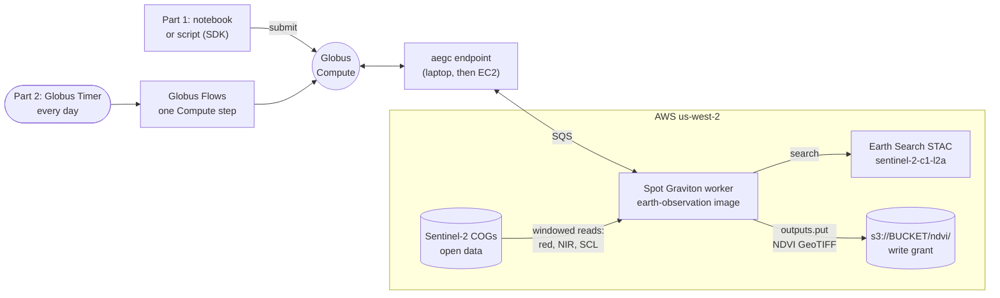

# Sentinel-2 NDVI, from a notebook to nightly

You'll compute NDVI, a vegetation index, for a field-sized area from the latest clear Sentinel-2
scene, first from a notebook or script, then every night with no laptop involved. The task reads
only the pixels over your area, straight from the open Sentinel-2 archive in us-west-2, on a Spot
Graviton worker that exists only while it runs.

**What it shows:**

- **Bytes read vs the full scene.** A Sentinel-2 tile is about 110 km across, and the red and NIR
  bands alone are over 400 MB. A windowed read of cloud-optimized GeoTIFFs (COGs) fetches only the
  blocks over the area of interest.
- **Dollars per run.** One small task on one Spot worker.
- **Scale to zero.** Between runs nothing is running in the pool, and the nightly part needs no
  laptop: the endpoint runs on a small EC2 instance and a Globus Timer starts the flow.



## Before you start

- **The [quickstart](../quickstart.md), once.** These steps assume the region is bootstrapped
  (`aegc bootstrap`), the endpoint image is built (`aegc endpoint build`) and you've logged in
  (`aegc endpoint login`). Run the commands from the root of the aegc source tree, with its
  `.venv` active.
- **Python 3.14 on your side.** The earth-observation image runs Python 3.14, and the client's
  minor version must match. If your `.venv` is another version, make a new one:
  `uv venv --python 3.14 .venv && uv pip install -e '.[cli]'`.
- **A bucket of yours for the results**, in us-west-2:

    ```sh
    export AWS_DEFAULT_REGION=us-west-2 BUCKET=<your bucket>
    aws s3 mb s3://$BUCKET   # if it doesn't exist yet
    ```

- **For part 2:** the [Globus CLI](https://docs.globus.org/cli/) (`pip install globus-cli`),
  logged in as the endpoint owner (see
  [Use the right identity](../how-to/flows.md#use-the-right-identity)), and the policy for the
  cloud endpoint on your AWS credentials (`aegc iam-policy endpoint-deployer` prints it; an
  administrator profile also works). Without a Globus subscription, Flows' free tier allows one
  flow per user, for 30 days.

**Cost.** Part 1 is well under $0.05: one Spot worker for a few minutes (the task, plus 5 minutes
idle before the worker leaves), and storage for the worker image in ECR (a few GB at $0.10 per
GB-month). Part 2 adds the cloud endpoint, a `t4g.micro` on-demand instance with a 30 GiB volume
and a public IPv4 address: about $0.40 a day while it runs. Each nightly run is another few
minutes of one Spot worker.

## Part 1: from a notebook

### 1. Build the worker image

The [aarch.science](https://aarch.science/) `earth-observation` image already has pystac-client,
rioxarray and rasterio. Find its newest immutable tag (aarchsci tags look like
`YYYY.MM.DD.HHMMSS`; never use `latest`):

```sh
curl -s 'https://quay.io/api/v1/repository/aarchsci/earth-observation/tag/?onlyActiveTags=true&limit=50' \
  | python3 -c 'import json, re, sys; print(max(t["name"] for t in json.load(sys.stdin)["tags"] if re.fullmatch(r"\d{4}(\.\d\d){2}\.\d{6}", t["name"])))'
```

At the time of writing that was `2026.11.21.153534`. Build from it:

```sh
aegc image build --env earth-observation --base-tag 2026.11.21.153534
aegc image list --env earth-observation    # one line, for Python 3.14
```

### 2. Deploy a pool with a write grant

```sh
aegc deploy ndvi --pool earth-observation:max_vcpus=4 \
  --grant write=s3://$BUCKET/ndvi/ --max-usd-day 2 --ttl 4h
```

This makes the pool `earth-observation-py314`, starting at zero workers. The write grant lets
tasks put their outputs under `s3://$BUCKET/ndvi/`, and nothing else in your account. The
sentinel data is read anonymously, so it needs no grant. `--ttl 4h` stops the deployment in
4 hours whatever happens; part 2 extends it.

### 3. Start an endpoint for it

```sh
ep() { aegc endpoint --name aegc-ndvi --deployment ndvi --env earth-observation "$@"; }
ep configure
ep start       # prints: started aegc-endpoint-aegc-ndvi; endpoint id <uuid>
export ENDPOINT_ID=<uuid>
```

### 4. Run the task

```sh
python examples/sentinel2-ndvi/run_ndvi.py --endpoint $ENDPOINT_ID
```

The script submits `ndvi_latest` for a 9 km × 11 km area in California's Central Valley
(`--bbox W S E N` for another one), waits for the result, prints it with the wall time and where
the task ran, and downloads the NDVI GeoTIFF into the current directory. The first run includes
a cold start: a worker boots and pulls the image.

In a notebook, the same thing is a cell (start Jupyter from the aegc `.venv` with
`uv pip install jupyterlab && jupyter lab`, from the source tree's root):

```python
import sys

sys.path.insert(0, "examples/sentinel2-ndvi")
from globus_compute_sdk import Executor
from globus_compute_sdk.serialize import ComputeSerializer, PureSourceTextInspect
from ndvi_tasks import ndvi_latest

ex = Executor(
    endpoint_id=ENDPOINT_ID,
    amqp_port=5671,
    user_endpoint_config={"env": "earth-observation"},
    serializer=ComputeSerializer(strategy_code=PureSourceTextInspect()),
)
summary = ex.submit(ndvi_latest, [-120.35, 36.75, -120.25, 36.85], 30, 20).result()
summary
```

`PureSourceTextInspect` sends the function as source text, so the worker doesn't need
`ndvi_tasks` installed, and it's the same form Flows needs in part 2.

### The code

The task, from [examples/sentinel2-ndvi/ndvi_tasks.py](../../examples/sentinel2-ndvi/ndvi_tasks.py):

```python
def ndvi_latest(bbox, days=30, max_cloud=20):
    """NDVI of the most recent low-cloud Sentinel-2 L2A scene over `bbox` in the last `days`.

    `bbox` is [west, south, east, north] in degrees. Reads only the window over the bbox from the
    red, NIR and scene-classification (SCL) COGs, masks clouds, shadows and nodata with SCL, writes
    a float32 NDVI GeoTIFF with `aegc.outputs.put`, and returns a small JSON summary.
    """
    import os
    import time
    from datetime import UTC, datetime, timedelta
    from pathlib import Path

    # Anonymous reads of the open bucket, and no directory listing per COG.
    os.environ["AWS_NO_SIGN_REQUEST"] = "YES"
    os.environ["GDAL_DISABLE_READDIR_ON_OPEN"] = "EMPTY_DIR"
    os.environ.setdefault("GDAL_HTTP_MERGE_CONSECUTIVE_RANGES", "YES")

    import numpy as np
    import pystac_client
    import rasterio.warp
    import rioxarray
    from rasterio.enums import Resampling

    from aegc import outputs

    def bytes_read():
        # Bytes this process has read (files and sockets): a close estimate of what came over
        # the network for the COG reads, once the imports are done. Linux only.
        try:
            for line in Path("/proc/self/io").read_text().splitlines():
                if line.startswith("rchar:"):
                    return int(line.split()[1])
        except OSError:
            pass
        return None

    t0 = time.monotonic()
    end = datetime.now(UTC)
    start = end - timedelta(days=days)
    search = pystac_client.Client.open("https://earth-search.aws.element84.com/v1").search(
        collections=["sentinel-2-c1-l2a"],
        bbox=bbox,
        datetime=f"{start:%Y-%m-%dT%H:%M:%SZ}/{end:%Y-%m-%dT%H:%M:%SZ}",
        query={"eo:cloud_cover": {"lt": max_cloud}},
        sortby="-properties.datetime",
        max_items=1,
    )
    items = list(search.items())
    if not items:
        return {"found": False, "bbox": bbox, "days": days, "max_cloud": max_cloud}
    item = items[0]

    def red_crs(item):
        code = item.properties.get("proj:code") or item.properties.get("proj:epsg")
        return code if str(code).startswith("EPSG:") else f"EPSG:{code}"

    def band(key, match=None):
        asset = item.assets[key]
        da = rioxarray.open_rasterio(asset.href, masked=True).squeeze("band", drop=True)
        da = da.rio.clip_box(*bbox, crs="EPSG:4326")
        if match is not None:
            da = da.rio.reproject_match(match, resampling=Resampling.nearest)
        info = (asset.extra_fields.get("raster:bands") or [{}])[0]
        scale, offset = info.get("scale", 1.0), info.get("offset", 0.0)
        return da, scale, offset, asset.extra_fields.get("file:size")

    # Look up the scene's CRS once, so PROJ's database reads don't count as bytes read.
    rasterio.warp.transform_bounds("EPSG:4326", red_crs(item), *bbox)
    before = bytes_read()
    red, red_scale, red_offset, red_size = band("red")
    nir, nir_scale, nir_offset, nir_size = band("nir")
    scl, _, _, scl_size = band("scl", match=red)  # 20 m, resampled onto the 10 m grid
    red_r = red * red_scale + red_offset
    nir_r = nir * nir_scale + nir_offset
    # SCL classes kept: 4 vegetation, 5 bare soil, 6 water, 7 unclassified, 11 snow.
    clear = scl.isin([4, 5, 6, 7, 11])
    ndvi = ((nir_r - red_r) / (nir_r + red_r)).where(clear).astype("float32")
    ndvi = ndvi.rio.write_nodata(np.nan, encoded=False)
    values = ndvi.values
    after = bytes_read()

    work = Path("/scratch") / f"ndvi-{outputs.task_uuid() or os.getpid()}"
    work.mkdir(parents=True, exist_ok=True)
    path = work / f"{item.id}_ndvi.tif"
    ndvi.rio.to_raster(path, driver="COG", compress="DEFLATE")
    uri = outputs.put(path)
    out_bytes = path.stat().st_size
    path.unlink()
    work.rmdir()

    valid = np.isfinite(values)
    sizes = [s for s in (red_size, nir_size, scl_size) if s]
    return {
        "found": True,
        "item": item.id,
        "datetime": item.properties.get("datetime"),
        "cloud_cover": item.properties.get("eo:cloud_cover"),
        "uri": uri,
        "shape": list(values.shape),
        "valid_fraction": round(float(valid.mean()), 4),
        "ndvi_mean": round(float(np.nanmean(values)), 4) if valid.any() else None,
        "bytes_read": (after - before) if before is not None and after is not None else None,
        "asset_bytes": sum(sizes) if len(sizes) == 3 else None,
        "output_bytes": out_bytes,
        "seconds": round(time.monotonic() - t0, 2),
    }
```

Points to know:

- **Everything is inside the function.** It's sent as source text, so module-level imports or
  helpers wouldn't travel with it. Its arguments and return value are JSON, for Flows.
- **The windowed read** is `rio.clip_box`: rioxarray opens each COG lazily, and only the blocks
  that cover the box are fetched, over HTTPS range requests. `file:size` in the STAC item gives
  each asset's full size for comparison.
- **The cloud mask** keeps the SCL classes for vegetation, bare soil, water, unclassified and
  snow, and drops nodata, saturated pixels, dark areas, cloud shadows, clouds and cirrus.
- **Reflectance.** The `sentinel-2-c1-l2a` collection stores digital numbers with a scale of
  0.0001 and an offset of -0.1 (in `raster:bands`); NDVI needs reflectance, so the task applies
  them.
- **`bytes_read`** comes from the task process's `rchar` counter in `/proc/self/io`, so it's
  approximate: it includes TLS overhead and any small local files read during the window reads.

!!! abstract "Results (part 1)"
    Measured on TODO(live) (date), worker image `earth-observation` 2026.11.21.153534.

    | Measure | Value |
    |---|---|
    | Scene | TODO(live) (item id, cloud cover) |
    | Window | TODO(live) pixels, valid fraction TODO(live) |
    | Bytes read (red, NIR, SCL windows) | TODO(live) MB |
    | Full size of those three assets | TODO(live) MB (`asset_bytes`) |
    | Share read | TODO(live) % |
    | NDVI GeoTIFF written | TODO(live) MB |
    | Wall time, cold (no workers) | TODO(live) s |
    | Wall time, warm (second run within 5 minutes) | TODO(live) s |
    | In-task time (`exec_s`) | TODO(live) s |
    | Instance | TODO(live) (type, Spot) |
    | Cost per run (`aegc cost`, including boot and idle) | $TODO(live) |
    | Back to zero workers after the last task | TODO(live) min |

## What to look at

```sh
aegc provenance ndvi <task id>   # instance, Spot or on-demand, zone, timings, estimated cost
aegc metrics ndvi                # the last hour: tasks, exec and queue-wait times, boot to claim
aegc cost ndvi                   # today's estimated spend from the workers' cost ledger
aegc status ndvi                 # workers in service; 0 about 5 minutes after the last task
```

`run_ndvi.py` prints the task id. The estimated cost in provenance uses on-demand prices, so for
a Spot task it's an upper bound on the task's share; `aegc cost` prices whole instance-hours,
boot and idle time included, at the Spot price. See
[Watch tasks](../how-to/observability.md).

## Part 2: nightly

Now make it run every night with your laptop closed. The endpoint moves to a small EC2 instance
with the same endpoint id, a one-step flow calls the function, and a timer starts the flow. See
[Use Globus Flows and Timers](../how-to/flows.md) for how the Compute action provider works with
aegc.

### 1. Register the function

As the endpoint owner (the identity you used for `aegc endpoint login`):

```sh
python examples/sentinel2-ndvi/register_ndvi.py   # prints the function id
export FUNCTION_ID=<function id>
```

It registers `ndvi_latest` as source text, as the Compute action provider needs.

### 2. Move the endpoint to EC2

Give the deployment room to run for a few nights, then deploy the cloud endpoint. It allows only
your function:

```sh
aegc deploy ndvi --pool earth-observation --ttl 3d
aegc status ndvi    # if part 1's 4-hour TTL has already frozen it, `aegc resume ndvi`
ep deploy --stop-local --allow-function $FUNCTION_ID --alarm-email you@example.org
aegc endpoint --deployment ndvi status
```

`ep deploy` builds the endpoint image for arm64 and pushes it to ECR, stores your endpoint's
Globus login in Secrets Manager, stops the local endpoint (`--stop-local`; one endpoint id runs in
one place), and starts a `t4g.micro` that runs the endpoint under the same id. It takes about
3 minutes to come online. `--alarm-email` sends you an email (confirm the SNS subscription first)
if the endpoint goes offline. The cloud endpoint renews the deployment's lease, like a local one.

With `--allow-function`, the endpoint runs only that function id. `run_ndvi.py` registers its own
copy when it submits, with an id of its own, so the endpoint refuses it (`403
FUNCTION_NOT_PERMITTED`) from now on; use the flow, or leave out `--allow-function` while you
experiment.

### 3. Create the flow and try it

[examples/sentinel2-ndvi/nightly.json](../../examples/sentinel2-ndvi/nightly.json) is a flow with
one Compute step. Fill in your ids, create it, and start one run by hand:

```sh
sed -e "s/ENDPOINT_ID/$ENDPOINT_ID/" -e "s/FUNCTION_ID/$FUNCTION_ID/" \
  examples/sentinel2-ndvi/nightly.json > ~/aegc-ndvi-nightly.json
globus flows create "aegc NDVI nightly" ~/aegc-ndvi-nightly.json   # prints the flow id
export FLOW_ID=<flow id>
globus flows start $FLOW_ID --label ndvi-try \
  --input '{"args": [[-120.35, 36.75, -120.25, 36.85], 5, 20]}'
globus flows run show <run id>
```

The first `start` may ask for consent to the flow's scopes: `globus login --flow $FLOW_ID`. The
step sets `user_endpoint_config` to `{"env": "earth-observation", "python": "3.14"}`: Flows
doesn't send a Python version the way the SDK does, so the flow says it. `WaitTime` is 1800 s, room
for a cold start. When the run is `SUCCEEDED`, the summary is in its output at
`NDVI.details.result[0]`, and the task id at `NDVI.details.results[0].task_id`, for
`aegc provenance`.

`days=5` in the input looks back 5 days, about one Sentinel-2 revisit, so most nights find the
latest pass, and some nights the same one again. The summary's `item` says which scene it was.

### 4. Run it every night

```sh
globus login --timer flow:$FLOW_ID
globus timer create flow $FLOW_ID --name aegc-ndvi-nightly \
  --start '2026-11-24T06:00:00+00:00' --interval 1d \
  --input '{"args": [[-120.35, 36.75, -120.25, 36.85], 5, 20]}'
globus timer list
```

Pick a `--start` in the future. Each night the timer starts a run, the run submits the task, the
pool starts a worker, and the worker leaves about 5 minutes after the task. After a few nights:

```sh
globus flows run list --filter-flow-id $FLOW_ID
aws s3 ls s3://$BUCKET/ndvi/ --recursive
aegc cost ndvi --since 3d
aegc metrics ndvi --since 3d
```

!!! abstract "Results (part 2)"
    Measured on TODO(live) (dates), over TODO(live) nights.

    | Measure | Value |
    |---|---|
    | Runs started by the timer / `SUCCEEDED` | TODO(live) / TODO(live) |
    | Flow run time, start to `SUCCEEDED` (cold) | TODO(live) s |
    | Workers running between runs | 0 (TODO(live): confirm with `aegc status`) |
    | Pool cost per night (`aegc cost`) | $TODO(live) |
    | Cloud endpoint per day (EC2, volume, IPv4; not in `aegc cost`) | $TODO(live) |
    | Cloud endpoint online within | TODO(live) min of `ep deploy` |

## Teardown

```sh
globus timer list                                   # the timer's id
globus timer delete <timer id>
globus flows delete $FLOW_ID
aegc destroy ndvi                                   # dry run: lists what goes
aegc destroy ndvi --yes                             # the pool, roles, queues and the cloud endpoint
aws s3 rm s3://$BUCKET/ndvi/ --recursive            # your outputs
aegc image forget --env earth-observation --python 3.14
rm ~/aegc-ndvi-nightly.json
```

`destroy` also removes the cloud endpoint: its instance group, launch template, role, login secret
and alarm. If you stopped after part 1, run `ep stop` before `destroy`. The ECR repository
`aegc/earth-observation` stays after `image forget`, and its lifecycle policy expires old
images; delete it with `aws ecr delete-repository --repository-name aegc/earth-observation --force`
if you're done with it. Delete the bucket too if you made it for this.
