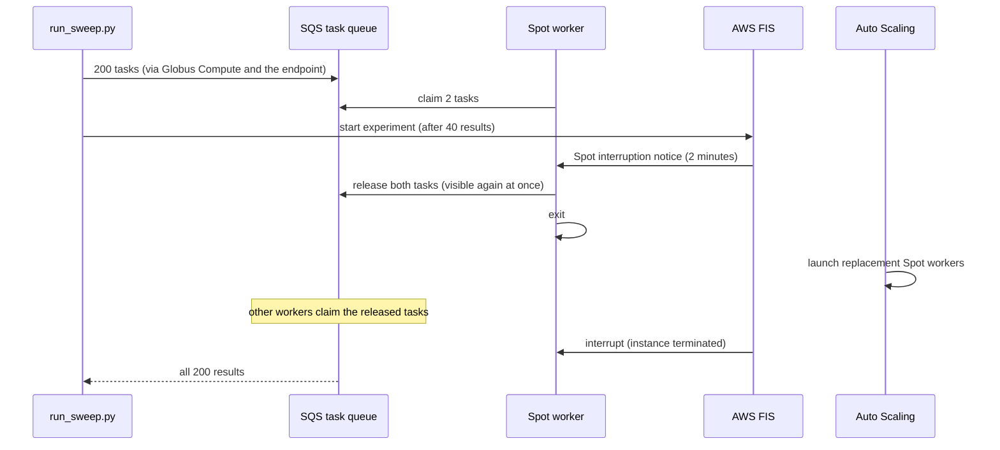

# A Spot sweep that survives interruptions

Spot capacity is cheap because AWS can take it back with two minutes' warning. You'll run a
200-task parameter sweep on Spot workers twice: once undisturbed, and once while
[AWS Fault Injection Service](https://docs.aws.amazon.com/fis/latest/userguide/what-is.html) (FIS)
sends real Spot interruption notices to half the workers mid-run. Then you'll check that every
task still came back, with the same answers.

**What it shows:**

- **Every task completes, correctly.** The task is deterministic, so the interrupted run's 200
  answers must match the undisturbed run's exactly.
- **What an interruption costs you.** aegc's workers watch for the notice, hand their running
  tasks back to the queue at once and leave; other workers pick the tasks up. `aegc metrics`
  counts the interruptions and the released tasks, and the wall time shows how much the
  interruptions added.
- **Spot vs on-demand.** `aegc cost` for the same sweep both ways, and what FIS itself costs
  ($0.10 per action-minute).



## Before you start

- **The [quickstart](../quickstart.md), once**: a bootstrapped region (us-west-2 here), the
  endpoint image and your Globus login. Run the commands from the root of the aegc source tree,
  with its `.venv` (Python 3.14) active.
- **Spot vCPU quota of at least 32** for standard instances in the region (`aegc deploy` warns if
  it's short). For the optional on-demand comparison, the same on-demand quota.
- **AWS credentials that can use FIS and create a role for it**: `iam:CreateRole`,
  `iam:AttachRolePolicy`, `iam:PassRole` on that role, `iam:DeleteRole`, and `fis:*` on experiment
  templates and experiments. An administrator profile works.

```sh
export AWS_DEFAULT_REGION=us-west-2
```

**Cost.** Each run is about 2.5 vCPU-hours of work (200 tasks of 30 to 60 s) on up to sixteen
2-vCPU Spot workers, plus each worker's boot and 5 idle minutes: roughly $0.10 to $0.20 per run
on Spot. FIS charges $0.10 per action-minute, and the interruption action lasts about 2 minutes,
so about $0.20 per experiment. The optional on-demand run costs roughly twice the Spot run.

## Steps

### 1. Build a plain Python image

The task needs nothing but Python, so the image is `python:3.14-slim` plus what aegc adds.
Pin the base by digest:

```sh
docker buildx imagetools inspect python:3.14-slim | grep Digest
aegc image build --env plain --base python:3.14-slim@sha256:<digest>
```

### 2. Deploy a Spot pool

```sh
aegc deploy sweep --pool plain:max_vcpus=32,vcpu=2 --max-usd-day 5 --ttl 4h
```

The pool is `plain-py314`: up to sixteen 2-vCPU Spot workers, each running two tasks at a time.
`vcpu=2` keeps the workers small, so an interruption takes out two tasks rather than eight, and
FIS has more instances to choose from.

### 3. Start an endpoint for it

```sh
ep() { aegc endpoint --name aegc-sweep --deployment sweep --env plain "$@"; }
ep configure
ep start       # prints: started aegc-endpoint-aegc-sweep; endpoint id <uuid>
export ENDPOINT_ID=<uuid>
```

### 4. Run the sweep undisturbed

```sh
python examples/spot-sweep/run_sweep.py --endpoint $ENDPOINT_ID \
  --save ~/aegc-sweep-baseline.json --provenance
```

It submits 200 tasks, prints progress every 20 results, checks that each task came back once with
its own bounds, saves the answers, and (with `--provenance`) asks Globus Compute where each task
ran and how many ran more than once. Note the wall time.

Wait until the pool is back to zero (`aegc status sweep`, about 5 minutes after the last task),
then read this run's cost. `--since` counts back from now, so give it the minutes since the run
started (the script prints the start time):

```sh
aegc cost sweep --since 15m --by type
```

### 5. Set up the interruption experiment

[examples/spot-sweep/fis.py](../../examples/spot-sweep/fis.py) makes, with boto3:

- an IAM role, `aegc-tutorial-fis-sweep-<region>`, that only FIS acting for your account can
  assume (an `aws:SourceAccount` condition), with the AWS managed policy
  `AWSFaultInjectionSimulatorEC2Access`;
- an experiment template with one action, `aws:ec2:send-spot-instance-interruptions` with
  `durationBeforeInterruption` `PT2M`, aimed at 50% of the running Spot instances tagged
  `aegc:deployment=sweep` and `aegc:pool=plain-py314`, the tags aegc puts on every worker.

Both are tagged `created-by=aegc-tutorial-spot-sweep` and `deployment=sweep`, and the script's
`cleanup` deletes only what carries those tags.

```sh
python examples/spot-sweep/fis.py setup --deployment sweep --pool plain-py314
```

### 6. Run it again, with interruptions

```sh
python examples/spot-sweep/run_sweep.py --endpoint $ENDPOINT_ID \
  --compare ~/aegc-sweep-baseline.json \
  --fis-deployment sweep --fis-pool plain-py314 --provenance
```

Once 40 results are in (`--fis-after`), the script starts the experiment. FIS picks half the
running workers and sends each a Spot interruption notice; two minutes later it interrupts them.
Watch the workers react in another terminal:

```sh
aws logs tail /aegc/sweep --follow --filter-pattern '"releasing in-flight"'
```

Each interrupted worker logs `interruption: releasing in-flight tasks and exiting`, makes its
tasks visible in the queue again, and leaves. The pool has capacity rebalancing on, so Auto
Scaling launches replacements, and the engine keeps scaling from the queue's depth. At the end
the script compares all 200 answers with the baseline, waits for the experiment to finish, and
prints which instances it interrupted.

Wait for zero workers again and read the cost, as in step 4.

### 7. Optional: the same sweep on demand

```sh
aegc deploy sweep --pool plain:on-demand
python examples/spot-sweep/run_sweep.py --endpoint $ENDPOINT_ID --compare ~/aegc-sweep-baseline.json
aegc cost sweep --since 15m --by type    # once the pool is back to zero
aegc deploy sweep --pool plain:spot      # back to Spot
```

A redeploy keeps the pool's other options, and running endpoints pick it up within a minute.

### The code

The task, from [examples/spot-sweep/sweep_tasks.py](../../examples/spot-sweep/sweep_tasks.py):
pure Python, CPU-bound, and the same answer on any machine.

```python
def collatz_chunk(index, size):
    """The longest Collatz chain among the start values index*size+1 .. (index+1)*size.

    Returns the chunk's bounds, the start value with the most steps to reach 1, that step count,
    and the total steps over the chunk (a checksum of the whole chunk).
    """
    import time

    t0 = time.monotonic()
    lo = index * size + 1
    best_n, best_steps, total = lo, 0, 0
    for n in range(lo, lo + size):
        steps = 0
        x = n
        while x != 1:
            x = x >> 1 if x & 1 == 0 else 3 * x + 1
            steps += 1
        total += steps
        if steps > best_steps:
            best_n, best_steps = n, steps
    return {
        "index": index,
        "lo": lo,
        "hi": lo + size - 1,
        "best_n": best_n,
        "best_steps": best_steps,
        "total_steps": total,
        "seconds": round(time.monotonic() - t0, 2),  # not part of the answer
    }
```

With the default `--size 5000000`, a task takes 25 to 40 s on an Apple M-series laptop; later
chunks hold bigger numbers with longer chains, so they take longer. The experiment template, from
[fis.py](../../examples/spot-sweep/fis.py):

```python
def template_request(
    *,
    deployment: str,
    pool: str,
    role_arn: str,
    percent: int = 50,
    before: str = "PT2M",
    client_token: str = "",
) -> dict[str, Any]:
    """The CreateExperimentTemplate request: interrupt `percent`% of the pool's running Spot
    workers, `before` (an ISO 8601 duration, PT2M to PT15M) after the notice."""
    if not 1 <= percent <= 100:
        raise ValueError(f"percent must be 1 to 100, not {percent}")
    return {
        "clientToken": client_token or str(uuid.uuid4()),
        "description": f"aegc tutorial: interrupt {percent}% of {deployment}/{pool} Spot workers",
        "roleArn": role_arn,
        "stopConditions": [{"source": "none"}],
        "targets": {
            "SpotWorkers": {
                "resourceType": "aws:ec2:spot-instance",
                "resourceTags": {AEGC_DEPLOYMENT: deployment, AEGC_POOL: pool},
                "filters": [{"path": "State.Name", "values": ["running"]}],
                "selectionMode": f"PERCENT({percent})",
            }
        },
        "actions": {
            "interrupt": {
                "actionId": "aws:ec2:send-spot-instance-interruptions",
                "description": "Spot interruption notice, then the interruption",
                "parameters": {"durationBeforeInterruption": before},
                "targets": {"SpotInstances": "SpotWorkers"},
            }
        },
        "tags": our_tags(deployment, pool),
    }
```

`tests/unit/test_examples.py` checks this request, and that its tag keys are the ones aegc puts
on workers, without calling AWS.

!!! abstract "Results"
    Measured on TODO(live) (date), 200 tasks, `--size 5000000`, pool `plain:max_vcpus=32,vcpu=2`.

    | Measure | Undisturbed (Spot) | With FIS (Spot) | On demand |
    |---|---|---|---|
    | Tasks completed, answers matching | TODO(live)/200 | TODO(live)/200, TODO(live) | TODO(live)/200 |
    | Wall time | TODO(live) min | TODO(live) min | TODO(live) min |
    | Time added by the interruptions | | TODO(live) min | |
    | Workers interrupted (FIS) | | TODO(live) of TODO(live) | |
    | `Interruptions` / `Releases` (`aegc metrics`) | 0 / 0 | TODO(live) / TODO(live) | 0 / 0 |
    | Tasks that ran more than once (`--provenance`) | TODO(live) | TODO(live) | TODO(live) |
    | Task time, avg / max | TODO(live) s / TODO(live) s | TODO(live) s / TODO(live) s | TODO(live) s / TODO(live) s |
    | Cost (`aegc cost`) | $TODO(live) | $TODO(live) | $TODO(live) |
    | FIS | | $TODO(live) (TODO(live) action-minutes) | |

## What to look at

```sh
aegc metrics sweep --since 3h     # per run window: completed, interruptions, releases, exec times
aegc provenance sweep <task id>   # a re-run task shows the released attempt and the one that finished
aegc status sweep                 # workers by type and the last scaling activity
```

A task that was running on an interrupted worker has two `task_finished` lines: one marked
`(released: not reported)` on the interrupted instance, and the one that posted the result on
another. `aegc metrics` counts each interruption notice under `Interruptions` and each task handed
back under `Releases`. See [Watch tasks](../how-to/observability.md).

## Teardown

```sh
python examples/spot-sweep/fis.py cleanup --deployment sweep         # dry run
python examples/spot-sweep/fis.py cleanup --deployment sweep --yes   # the template and the role
ep stop
aegc destroy sweep --yes
aegc image forget --env plain --python 3.14
rm ~/aegc-sweep-baseline.json
```

FIS keeps a record of past experiments, which can't be deleted and costs nothing. Keep the
`plain` image if you're going on to [One flow, two endpoints](two-endpoints.md), which uses it
too.
