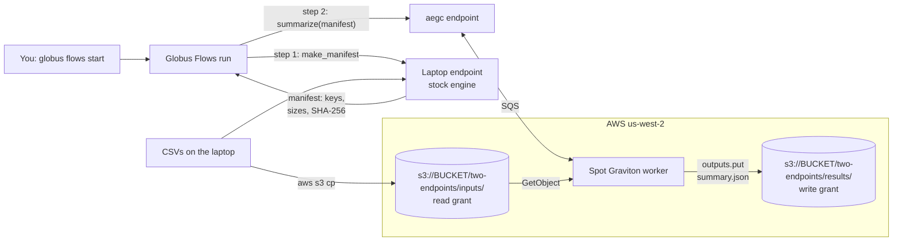

# One flow, two endpoints

Some steps belong where the data is made, and some where there's capacity. You'll build a Globus
flow with two Compute steps on two endpoints: the first on a stock Globus Compute endpoint on your
laptop, which knows which files it produced and writes a manifest with their checksums; the
second on aegc, which reads those files from S3, checks them against the manifest, sums them up,
and returns the summary's `s3://` URI. Then you'll run the same flow with both steps on the laptop
and compare.

**What it shows:**

- **One flow, the right place for each step.** Flows passes the first step's JSON result to the
  second; neither endpoint knows about the other.
- **Laptop vs cloud time** for the same `summarize` function: on the laptop it downloads every
  file over your connection, on aegc it reads them in the region.
- **Dollars per run** on aegc, against S3 egress for the laptop run.



## Before you start

- **The [quickstart](../quickstart.md), once**: a bootstrapped region (us-west-2 here), the
  aegc endpoint image and your Globus login. Run the commands from the root of the aegc source
  tree, with its `.venv` (Python 3.14) active.
- **The `plain` worker image**, `python:3.14-slim` plus aegc. If you did
  [the Spot sweep](spot-sweep.md) it exists; otherwise:

    ```sh
    docker buildx imagetools inspect python:3.14-slim | grep Digest
    aegc image build --env plain --base python:3.14-slim@sha256:<digest>
    ```

- **The [Globus CLI](https://docs.globus.org/cli/)**, logged in as the owner of both endpoints:
  a Compute step runs as the identity that started the flow, which must be allowed on its
  endpoint. See [Use the right identity](../how-to/flows.md#use-the-right-identity).
  Without a Globus subscription, Flows' free tier allows one flow per user, for 30 days: delete
  the [NDVI tutorial's](sentinel2-ndvi.md) flow first if you made it.
- **A bucket of yours** in us-west-2:

    ```sh
    export AWS_DEFAULT_REGION=us-west-2 BUCKET=<your bucket>
    aws s3 mb s3://$BUCKET   # if it doesn't exist yet
    ```

**Cost.** Each aegc run is a few minutes of one Spot worker, well under $0.05. The laptop run
downloads the data from S3, about 0.5 GB with the defaults: about $0.04 of internet egress at
$0.09 per GB. Storing the inputs costs about $0.01 a month.

## Steps

### 1. Make the data and upload it

```sh
python examples/two-endpoints/make_data.py ~/aegc-two-endpoints/data --files 20 --mb 25
aws s3 cp ~/aegc-two-endpoints/data/ s3://$BUCKET/two-endpoints/inputs/ --recursive
```

Twenty CSVs of about 25 MB each, `sensor,ts,value` rows from a fixed seed. In real life these
would be an instrument's output, copied up as it's made.

### 2. Start a laptop endpoint

The laptop endpoint is a stock `globus-compute-endpoint` with its default engine, which runs
tasks in worker processes on the same machine. `globus-compute-endpoint` needs Linux (on macOS,
`configure` stops with `Compute endpoints are not supported on this system`), so run it in
Docker. The `aegc-endpoint` image from the quickstart has `globus-compute-endpoint` and boto3,
and runs a stock endpoint just as well. Using aegc's volume `aegc-endpoint-home` reuses your
Globus login, so both endpoints belong to the same identity:

```sh
docker run --rm -v aegc-endpoint-home:/home/gc/.globus_compute aegc-endpoint \
  globus-compute-endpoint configure laptop
docker run -d --name gce-laptop --restart unless-stopped \
  -v aegc-endpoint-home:/home/gc/.globus_compute \
  -v ~/aegc-two-endpoints/data:/data:ro \
  -v ~/.aws:/home/gc/.aws:ro -e AWS_PROFILE -e AWS_DEFAULT_REGION \
  -e GC_ENDPOINT=laptop aegc-endpoint
docker exec gce-laptop globus-compute-endpoint list   # laptop's id, once it shows as running
export LAPTOP_ID=<laptop's endpoint id>
```

The data directory is mounted at `/data`, which is where `make_manifest` looks. The AWS
credentials are for the comparison run in step 7, where `summarize` runs on the laptop endpoint
and reads S3 with them. On a Linux laptop you can instead install `globus-compute-endpoint`
4.21.0 and boto3 in a virtual environment, and `configure` and `start` it there, with that
environment's `bin/` on `PATH` (the engine starts its workers from it); then use the data's real
path in place of `/data` in the run's input (step 6).

### 3. Deploy aegc with read and write grants

```sh
aegc deploy twoep --pool plain:max_vcpus=4 \
  --grant read=s3://$BUCKET/two-endpoints/inputs/ \
  --grant write=s3://$BUCKET/two-endpoints/results/ \
  --max-usd-day 2 --ttl 4h
ep() { aegc endpoint --name aegc-twoep --deployment twoep --env plain "$@"; }
ep configure
ep start       # prints: started aegc-endpoint-aegc-twoep; endpoint id <uuid>
export AEGC_ID=<uuid>
```

Tasks can now read the inputs and write the results, and nothing else in your account.

### 4. Register the two steps

```sh
python examples/two-endpoints/register_steps.py
```

It registers `make_manifest` and `summarize` as source text and prints their function ids. Keep
them:

```sh
export MANIFEST_ID=<make_manifest id> SUMMARIZE_ID=<summarize id>
```

To let the aegc endpoint run only `summarize`, add `--allow-function $SUMMARIZE_ID` to
`ep configure`, then `ep stop` and `ep start` (see
[Allow only your functions](../how-to/flows.md#allow-only-your-functions)).

### 5. Create the flow

[examples/two-endpoints/two_endpoints.json](../../examples/two-endpoints/two_endpoints.json) has
two Action states on the Compute action provider. It takes every id from the run's input, so the
same flow runs either way:

```json
{
  "Comment": "aegc tutorial: a manifest from a laptop endpoint, the work on aegc next to the data",
  "StartAt": "Manifest",
  "States": {
    "Manifest": {
      "Type": "Action",
      "ActionUrl": "https://compute.actions.globus.org/v3",
      "Parameters": {
        "endpoint_id.$": "$.laptop_endpoint",
        "tasks": [{"function_id.$": "$.manifest_function", "args.$": "$.manifest_args"}]
      },
      "ResultPath": "$.Manifest",
      "WaitTime": 600,
      "Next": "Summarize"
    },
    "Summarize": {
      "Type": "Action",
      "ActionUrl": "https://compute.actions.globus.org/v3",
      "Parameters": {
        "endpoint_id.$": "$.process_endpoint",
        "user_endpoint_config.$": "$.process_config",
        "tasks": [{"function_id.$": "$.summarize_function", "args.$": "$.Manifest.details.result"}]
      },
      "ResultPath": "$.Summary",
      "WaitTime": 1800,
      "End": true
    }
  }
}
```

The hand-off is `"args.$": "$.Manifest.details.result"`: the first step's results, a list with
the one manifest in it, become the second step's argument list. `process_config` carries aegc's
`user_endpoint_config`, with `python`, since Flows doesn't send a Python version.

```sh
globus flows create "aegc two endpoints" examples/two-endpoints/two_endpoints.json
export FLOW_ID=<flow id>
globus login --flow $FLOW_ID          # consent to the flow's scopes, once
```

### 6. Run it: manifest on the laptop, work on aegc

Fill in [input.json](../../examples/two-endpoints/input.json) and start a run:

```sh
sed -e "s/LAPTOP_ENDPOINT_ID/$LAPTOP_ID/" -e "s/AEGC_ENDPOINT_ID/$AEGC_ID/" \
  -e "s/MANIFEST_FUNCTION_ID/$MANIFEST_ID/" -e "s/SUMMARIZE_FUNCTION_ID/$SUMMARIZE_ID/" \
  -e "s/\"BUCKET\"/\"$BUCKET\"/" \
  examples/two-endpoints/input.json > ~/aegc-two-endpoints/input-cloud.json
globus flows start $FLOW_ID --label cloud --input ~/aegc-two-endpoints/input-cloud.json
globus flows run show <run id>
globus flows run show-logs <run id>   # when each step started and finished
```

When the run is `SUCCEEDED`, `Summary.details.result[0]` holds the summary's URI
(`s3://$BUCKET/two-endpoints/results/<task uuid>/summary.json`), how many files were verified
against the laptop's checksums, the rows and bytes read, and the seconds the task took.

### 7. Run it again: both steps on the laptop

```sh
python3 -c 'import json, sys; d = json.load(open(sys.argv[1])); d.update(process_endpoint=sys.argv[2], process_config={}); print(json.dumps(d))' \
  ~/aegc-two-endpoints/input-cloud.json $LAPTOP_ID > ~/aegc-two-endpoints/input-laptop.json
globus flows start $FLOW_ID --label laptop --input ~/aegc-two-endpoints/input-laptop.json
```

Now `summarize` runs on the laptop endpoint: it downloads every file from S3 with your own
credentials, and writes the summary to a temporary file in the endpoint's container
(`file:///tmp/...` in the result) instead of S3. Compare the two runs' `Summary` step times in
`show-logs`, and the `seconds` in each result.

### The code

The two steps, from [examples/two-endpoints/steps.py](../../examples/two-endpoints/steps.py).
Each imports what it needs inside itself, because it's sent as source text, and both take and
return JSON:

```python
def make_manifest(data_dir, bucket, prefix):
    """The CSVs in `data_dir` as S3 keys under `prefix`, with their sizes and SHA-256 sums."""
    import hashlib
    import platform
    import time
    from pathlib import Path

    t0 = time.monotonic()
    items = []
    for path in sorted(Path(data_dir).expanduser().glob("*.csv")):
        with path.open("rb") as f:
            digest = hashlib.file_digest(f, "sha256").hexdigest()
        items.append({"key": prefix + path.name, "bytes": path.stat().st_size, "sha256": digest})
    return {
        "bucket": bucket,
        "items": items,
        "made_on": platform.node(),
        "seconds": round(time.monotonic() - t0, 2),
    }
```

```python
def summarize(manifest):
    """Per-sensor count, mean, min and max over the manifest's files, checked against its sums.

    On aegc the summary goes to S3 with `aegc.outputs.put`; anywhere else (the laptop endpoint,
    for the comparison) to a local temporary file. Returns where it went and what was read.
    """
    import csv
    import hashlib
    import io
    import json
    import os
    import platform
    import tempfile
    import time
    from concurrent.futures import ThreadPoolExecutor

    import boto3

    t0 = time.monotonic()
    s3 = boto3.client("s3")
    bucket, items = manifest["bucket"], manifest["items"]

    def fetch(item):
        return item, s3.get_object(Bucket=bucket, Key=item["key"])["Body"].read()

    sensors = {}  # sensor -> [count, sum, min, max]
    verified, mismatched, nbytes, rows = 0, [], 0, 0
    with ThreadPoolExecutor(8) as pool:
        for i in range(0, len(items), 8):  # eight files in memory at a time
            for item, body in pool.map(fetch, items[i : i + 8]):
                nbytes += len(body)
                if hashlib.sha256(body).hexdigest() != item["sha256"]:
                    mismatched.append(item["key"])
                    continue
                verified += 1
                for row in csv.DictReader(io.StringIO(body.decode())):
                    v = float(row["value"])
                    s = sensors.setdefault(row["sensor"], [0, 0.0, v, v])
                    s[0] += 1
                    s[1] += v
                    s[2] = min(s[2], v)
                    s[3] = max(s[3], v)
                    rows += 1
    summary = {
        "files": len(items),
        "rows": rows,
        "sensors": {
            k: {"count": c, "mean": round(t / c, 4), "min": lo, "max": hi}
            for k, (c, t, lo, hi) in sorted(sensors.items())
        },
    }
    data = json.dumps(summary, indent=1).encode()
    if os.environ.get("AEGC_TASK_UUID"):  # on an aegc worker
        from aegc import outputs

        where = outputs.put(data, name="summary.json")
    else:
        fd, path = tempfile.mkstemp(prefix="aegc-two-endpoints-", suffix=".json")
        os.write(fd, data)
        os.close(fd)
        where = "file://" + path
    return {
        "summary": where,
        "files": len(items),
        "verified": verified,
        "mismatched": mismatched,
        "rows": rows,
        "bytes": nbytes,
        "ran_on": platform.node(),
        "seconds": round(time.monotonic() - t0, 2),
    }
```

On aegc, boto3 finds the task role's credentials by itself, and the read grant covers the
inputs. `AEGC_TASK_UUID` is set on aegc workers for each task, which is how `summarize` knows
where it is.

!!! abstract "Results: not yet run live"
    This tutorial hasn't been run live yet; the values marked `TODO(live)` will come from that
    run. Measured on TODO(live) (date), 20 files of 25 MB (TODO(live) GB in all), laptop TODO(live)
    (machine, connection).

    | Measure | Laptop + aegc | Laptop only |
    |---|---|---|
    | `Manifest` step (start to finish, `show-logs`) | TODO(live) s | TODO(live) s |
    | `Summarize` step (start to finish) | TODO(live) s (cold) | TODO(live) s |
    | `summarize` in-task time (`seconds`) | TODO(live) s | TODO(live) s |
    | Whole run, start to `SUCCEEDED` | TODO(live) s | TODO(live) s |
    | Files verified against the manifest | TODO(live)/20 | TODO(live)/20 |
    | Bytes over your internet connection | TODO(live) (the manifest, the result) | TODO(live) GB |
    | Cost | $TODO(live) (`aegc cost`) | $TODO(live) egress |

## What to look at

```sh
globus flows run show-logs <run id>   # each step's start and end
aegc provenance twoep <task id>       # the task id is in Summary.details.results[0].task_id
aegc cost twoep
aws s3 cp s3://$BUCKET/two-endpoints/results/<task uuid>/summary.json -
```

The cloud step's time includes a cold start when the pool is at zero; run the flow again within
5 minutes to see it warm.

!!! note "Aside: a Transfer step instead of `aws s3 cp`"
    Here the data reaches S3 with `aws s3 cp`. A Globus-native version would start the flow with
    a Transfer step from your lab's Globus collection to an S3 collection, so Globus moves and
    checks the files, then run the two Compute steps.
    [aws-elastic-gcs](https://github.com/scttfrdmn/aws-elastic-gcs), the sister project, runs
    Globus Connect Server with its S3 connector in your account for that. It needs a Globus
    subscription (the S3 connector is a subscription feature) and a GCS S3 collection on the
    bucket the read grant covers.

## Teardown

```sh
globus flows delete $FLOW_ID
ep stop
aegc destroy twoep --yes
aws s3 rm s3://$BUCKET/two-endpoints/ --recursive
docker exec gce-laptop globus-compute-endpoint stop laptop
docker rm -f gce-laptop
docker run --rm -v aegc-endpoint-home:/home/gc/.globus_compute aegc-endpoint \
  globus-compute-endpoint delete laptop --yes    # and its registration with Globus
rm -r ~/aegc-two-endpoints
aegc image forget --env plain --python 3.14
```

Keep the `plain` image (skip `image forget`) if you'll use it again.
